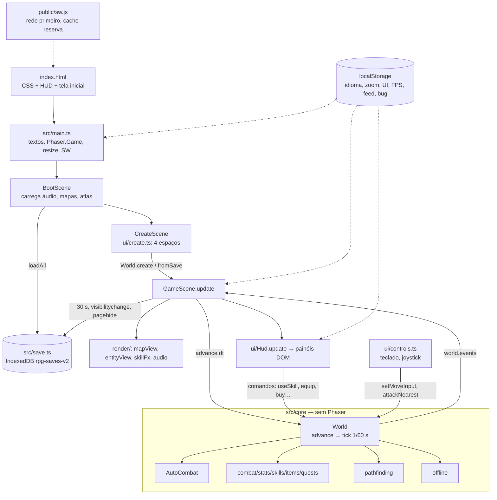

# Auditoria do código — Wanderers (17/11/2026)

> Etapa somente de leitura: **nenhum arquivo de código foi alterado**. Este documento é o relatório e o plano.
> Base: branch `claude/blissful-pasteur-p7k6wj` = `main` no commit `6055d6f` (PR #23).
> Conferido nesta auditoria: `npm run typecheck` ✅, `npm run build` ✅ (JS de 1,7 MB / 420 KB gzip),
> `check:items`, `check:auto`, `check:skills`, `check:i18n`, `check:m5`, `check:quests`, `check:respawn` — **todos passam**.
> `check:layout` não foi rodado (precisa de servidor de preview + navegador).

---

## 1. Resumo executivo

O projeto está **em bom estado para um jogo de 3 dias de marcos**: a lógica (`src/core/`) é separada do Phaser como decidido, tudo é
guiado por JSON, há 7 testes automáticos que passam e os comentários costumam explicar o *porquê*. O problema central de manutenção é
**densidade**: linhas de até 385 caracteres com várias instruções, um `World` de 1.244 linhas que faz tudo, CSS de ~300 linhas dentro
do `index.html` e conhecimento de mapa espalhado em 5 arquivos. Para as lojas, a base é boa (caminhos relativos, sem anúncios/analytics),
mas falta a camada de plataforma.

**5 maiores riscos**
1. **Perda de save** — `src/save.ts:11` engole erro de leitura do IndexedDB e devolve arquivo vazio; o próximo `writeSave` grava por cima
   dos 4 personagens. No iPhone isso acontece de verdade (bug conhecido do WebKit "Connection to Indexed Database server lost").
2. **`World` como "classe-deus"** — `src/core/world.ts` (1.244 linhas, 60 KB) mistura combate, inventário, loja, ferreiro, NPCs, missões,
   chefe, offline e save. Toda feature nova (Marcos 8–9) vai passar por ele.
3. **Ciclo de vida no app nativo** — o ganho offline só é calculado ao *abrir* o jogo (`World.fromSave`). No celular o app volta do
   segundo plano sem recarregar, então o tempo fora é perdido (o loop limita o atraso a 0,25 s em `world.ts:420`).
4. **Sem camada de plataforma** — `localStorage` em 6 arquivos, service worker em `main.ts:69`, `window.location.reload()` em 3 lugares,
   sem botão Voltar do Android, sem política de privacidade (o report de bug envia dados a terceiro).
5. **Memória em celular fraco** — todos os atlas são carregados no boot (~95 MB de textura descomprimida, 8 atlas 2048 px de largura),
   incluindo a seita que o jogador não usa e monstros de mapas onde ele não está.

---

## 2. Mapa do projeto

### 2.1 Estrutura de pastas (1 linha por item)

| Caminho | Função |
|---|---|
| `index.html` | Página única: tela de carregamento, HUD em HTML, tela inicial **e todo o CSS do jogo** (~300 linhas inline). |
| `vite.config.ts` | Build: `base: './'` (caminhos relativos) e injeta `__APP_VERSION__`/`__BUILD__`. |
| `tsconfig.json` | TS estrito; inclui só `src/` (os `tools/*.ts` não passam pelo `tsc`). |
| `package.json` | Scripts de dev/build/checks; dependências: `phaser`, `idb-keyval`. |
| `.github/workflows/deploy.yml` | Build e publicação no GitHub Pages a cada push na `main` (não roda os testes). |
| `.vscode/settings.json` | PATH do Node portátil do Lucas no terminal do VSCode. |
| `README.md` | Como rodar e estrutura — **desatualizado** (ainda diz "Marco 1"). |
| `docs/decisoes-do-projeto.md` | Registro oficial de decisões (fonte da verdade). |
| `docs/balanceamento.md` | Método e resultados do simulador — **números do marco 5**, vários já mudaram. |
| `src/main.ts` | Ponto de entrada: textos fixos, cria o `Phaser.Game`, resize, registra o service worker. |
| `src/save.ts` | Save no IndexedDB (`idb-keyval`), 4 espaços, migração do save antigo. |
| `src/globals.d.ts` | Tipos das constantes injetadas pelo Vite. |
| `src/core/` | **Regras do jogo sem Phaser** (World, combate, auto, itens, missões, offline, A*, i18n). |
| `src/core/world.ts` | Estado inteiro de uma partida + todas as regras + serialização. |
| `src/core/auto.ts` | Auto-combate (escolha de alvo, poções, viagem à vila, medição do ritmo para o offline). |
| `src/core/offline.ts` | Cálculo do ganho offline a partir do ritmo medido. |
| `src/core/items.ts` | Bases, raridades, bônus, preços, conserto, ordenação da mochila. |
| `src/core/quests.ts` | Tipos e dados da cadeia de missões. |
| `src/core/skills.ts` | Definições de skills, escala por nível, XP de skill. |
| `src/core/combat.ts` | Rolagem de acerto/crítico/dano. |
| `src/core/stats.ts` | Atributos → stats derivados; decomposição base/níveis/equip. |
| `src/core/data.ts` | Carrega classes, monstros, progressão, falas (com tradução). |
| `src/core/saves.ts` | Formato do arquivo de saves (slots) e migração; "há 2 h". |
| `src/core/map.ts` | Lê o JSON no formato Tiled → `GameMap`. |
| `src/core/pathfinding.ts` | A* em grade e áreas a evitar. |
| `src/core/iso.ts` | Conversão tile ↔ tela isométrica. |
| `src/core/rng.ts` | Gerador pseudoaleatório com semente. |
| `src/core/distribute.ts` | "Distribuir recomendado" dos pontos. |
| `src/core/i18n.ts` | `L('pt','en')`, idioma, `localize()` sobre os JSON. |
| `src/data/*.json` | Dados do jogo (PT) + `en.json` (traduções). `src/data/sprites/*.json` = metadados das folhas. |
| `src/scenes/` | Cenas Phaser: `Boot` (carrega), `Create` (tela inicial), `Game` (loop e ponte core↔tela). |
| `src/render/` | Desenho no Phaser: mapa, entidades, sprites, efeitos de skill, áudio, texturas placeholder, DPR. |
| `src/ui/` | HUD e janelas em DOM (17 arquivos): hotbar, mochila, NPC, auto, minimapa, dicas/config, report de bug… |
| `public/` | Arquivos servidos como estão: `maps/`, `sprites/` (atlas PNG + JSON de quadros), `audio/` (ogg+mp3), `icons/`, `manifest.webmanifest`, `sw.js`. |
| `tools/*.ts` | Testes de regra (`*-check.ts`) e o simulador de balanceamento (`balance-sim.ts`). |
| `tools/gen-maps.mjs` | **Gera** os 3 mapas no formato Tiled (não são editados no Tiled — ver §3). |
| `tools/layout-check.mjs` | Teste de sobreposição do HUD com Playwright em 7 tamanhos de tela. |
| `tools/sprites/` | Pipeline Blender (Python) que renderiza modelos 3D CC0 em atlas; configs JSON por folha. |
| `tools/icons/make_app_icons.py` | Gera os ícones do PWA. |

> Atenção para o recém-chegado: existem **três famílias de JSON com o mesmo nome** — `tools/sprites/lobo.json` (config do render),
> `public/sprites/lobo.json` (quadros do atlas, lido pelo Phaser) e `src/data/sprites/lobo.json` (animações/âncora, importado no TS).

### 2.2 Arquitetura atual



| Peça | Como funciona hoje |
|---|---|
| **Entrada** | `index.html` → `src/main.ts`: `captureErrors()`, escala da UI, bloqueio do zoom do navegador, ícones, textos fixos, `new Phaser.Game` com canvas em resolução × DPR (máx. 2). |
| **Loop** | `GameScene.update(delta)` → `World.advance(dt)` acumula e roda `tick(1/60)` com teto de 0,25 s por quadro (`world.ts:419-422`). Depois consome `world.events` e sincroniza views e HUD. |
| **Estado** | Tudo dentro de uma instância de `World` (jogador, monstros, NPCs, mochila, missão, auto). Não há estado global além dos singletons `audio` (`render/audio.ts:143`) e `perf`, e das variáveis de módulo de `save.ts` e `uiScale.ts`. A UI lê o `World` direto a cada quadro e compara "assinaturas" (`panelSig`, `invVersion`) para redesenhar. |
| **Renderização** | Phaser 3 (WebGL/Canvas). Mapa em imagens isométricas com profundidade `x+y`; casas em fatias de 32 px; árvores ficam transparentes perto do jogador. HUD e janelas são **DOM** por cima do canvas. |
| **Input** | Teclado em `window` (`controls.ts:9`); mouse/toque no canvas pelo Phaser (`gameScene.ts:64`); joystick flutuante e botões em DOM (Pointer Events); pinça para zoom. |
| **Áudio** | `AudioManager` sobre o som do Phaser; sfx ogg/mp3 pré-carregados; música carregada sob demanda com fade; desbloqueio do iOS via `sound.locked`/`unlocked` (`audio.ts:105`). Volumes ficam **no save do personagem**. |
| **Persistência** | Saves: IndexedDB via `idb-keyval`, chave `rpg-saves-v2` (+ migração de `rpg-save-v1`). Preferências do aparelho: `localStorage` (`rpg-wuxia-lang`, `rpg-zoom`, `rpg-ui-size`, `rpg-fps`, `rpg-bug-last` e a do feed de itens). Gravação a cada 30 s, ao esconder a aba e no `pagehide`. |
| **Service worker** | `public/sw.js`: rede primeiro, cache como reserva, ignora outras origens; cache `wanderers-v1` nunca muda de nome. Registrado só em produção (`main.ts:69`). |
| **Manifest** | `public/manifest.webmanifest`: fullscreen, orientação livre, ícones 192/512/512-maskable; `apple-touch-icon` 180 no HTML. |
| **Assets** | 8,5 MB em `public/` (5 MB sprites, 3,3 MB áudio em dois formatos). Todos os atlas e sfx carregados no `BootScene`; música sob demanda. |

---

## 3. Decisões encontradas e se o código as respeita

Fontes lidas: `docs/decisoes-do-projeto.md` (principal), `docs/balanceamento.md`, `README.md`, `tools/sprites/README.md`,
`docs/musica.md` (antes `public/audio/music/README.md`), `public/*/CREDITS.txt`, o `_doc` de `src/data/items.json` e comentários com "aprovado/decidido" no código.
Não existem `CLAUDE.md`, `CHANGELOG` nem `CONTRIBUTING`.

Legenda: ✅ respeitada · ⚠️ divergência · ℹ️ não verificável no código

### Regras de trabalho e processo (decisoes-do-projeto.md §Regras)
| Decisão | Status |
|---|---|
| Toda decisão é registrada em `docs/decisoes-do-projeto.md`. | ✅ (mas ver divergências abaixo) |
| Decisões de jogabilidade sempre perguntadas ao Lucas, em múltipla escolha. | ℹ️ — este plano segue isso (§8). |
| Avisar dicas de economia de tokens; rotina vai para modelo mais leve. | ℹ️ — ver nota no fim. |
| Melhorias só entram em "Futuro" se aprovadas e só são feitas a pedido. | ✅ |

### Base, tecnologia e plataforma
| Decisão (fonte) | Status |
|---|---|
| Single-player primeiro; lógica separada da renderização para o multiplayer (§Base). | ✅ `src/core` não importa Phaser, `ui` nem `render`. Ressalva: `core/i18n.ts` lê `window`/`localStorage`. |
| PC e celular (§Base). | ✅ |
| TypeScript + Vite + Phaser 3 (§Tecnologia). | ✅ |
| **Mapas feitos no Tiled** (§Tecnologia). | ⚠️ Os mapas são **gerados por script** (`tools/gen-maps.mjs`) no formato Tiled; ninguém edita no Tiled. Atualizar o texto da decisão ou confirmar que continua assim. |
| Dados em JSON (data-driven) (§Tecnologia). | ✅ com exceções: mapas conhecidos em código (`bootScene.ts:8`, `auto.ts:8`, `mapView.ts:18,26`). |
| Save local em IndexedDB com horário da última sessão; separado por aparelho até o marco online (§Base, §Marco 7). | ✅ |
| Publicação no GitHub Pages a cada push (§Repositório). | ✅ `deploy.yml`. |
| Contínuo (proposto): rodar checks no Actions. | ⚠️ ainda não feito (o workflow só faz build). |

### Idioma e nomes
| Decisão | Status |
|---|---|
| PT e EN; `L('pt','en')`; JSON em PT + `en.json`; `check:i18n`. | ✅ |
| Ids internos antigos mantidos (`lamina`, `pavilhao`, `corte_duplo`…) para não quebrar saves. | ✅ — recomendações deste plano **não renomeiam ids salvos**. |
| Nome "Wanderers"; repositório e assunto `[RPG bug]` mantidos. | ✅ (`bugReport.ts:125`). |
| Primeira vez: idioma do navegador; troca recarrega a página. | ✅ `i18n.ts:6-25`. |

### Combate, atributos, skills, itens (amostra conferida com os JSON)
| Decisão | Status |
|---|---|
| 5 pontos por nível (2 automáticos + 3 livres); "Distribuir recomendado". | ✅ `progression.json`, `world.ts:231`. |
| Regeneração só na cidade, 3%/s após 5 s sem dano. | ✅ `world.ts:23,451`. |
| Skill máx. nv 10, +8%/nível, ~20 usos para o nv 2. | ✅ `skills.ts:127-132`. |
| Números das skills do marco 7 (Quebra-Guarda 280% / −40%, roubo de vida 8%). | ✅ `skills.json`, `classes.json`. |
| **Geada: Stamina inicial 5 → 8** (§Fechamento do marco 7). | ⚠️ **O código tem 10** (`classes.json`, alterado no PR #17). Pergunta P1. |
| Morte: −10% da durabilidade máx.; desgaste 0,3 por golpe. | ✅ `world.ts:27`, `items.json` `wearPerHit`. |
| Mochila 30, pilha 99, venda 15%, preços P/G das poções. | ✅ `items.json`. |
| XP dos monstros −22% e ouro pela metade (marco 7). | ✅ `monsters.json` (lobo 8+5, ouro 2–5…). |
| Respawn comum 30 s, General 10 min, contando fora do mapa. | ✅ `monsters.json`, `world.ts` `respawnAtMs`. |

### Auto-combate e offline
| Decisão | Status |
|---|---|
| Ataca até 2 níveis acima; revida primeiro; evita grupos; ≤12 tiles; 16 candidatos; ignora 15 s. | ✅ `auto.ts:9-17`. |
| Padrão de poções 40% / 30%; descanso com HP < 35%. | ✅ `auto.ts:22,28`. |
| Offline: 60/40/20/0% por faixa, só se saiu com auto ligado, sem morte. | ✅ `offline.ts:6`, `world.ts` `applyOffline`. |
| Offline só para o último personagem jogado. | ✅ `createScene.ts`. |
| Ganho offline **não conta** para missões. | ✅ |

### Interface, gráficos e som
| Decisão | Status |
|---|---|
| Estilo: KayKit/Kenney/Quaternius CC0 renderizados no Blender, 8 direções, 2× mostrado em 0,5, sem contorno. | ✅ `tools/sprites/README.md`, `mapView.ts:27`. |
| Regra de cor: cenário nunca usa a cor dos inimigos do mapa. | ℹ️ visual; documentado em `mapView.ts:13`. |
| Zoom 100–200% salvo no aparelho. | ✅ `gameScene.ts:21`. |
| Nitidez: canvas × DPR (máx. 2). | ✅ `display.ts:3`. |
| Tamanho da interface (Auto/P/M/G) com limite para caber. | ✅ `uiScale.ts`. |
| Joystick flutuante (PR #20, **em teste, pode voltar atrás**). | ✅ isolado em `controls.ts:37`. O plano não mexe nele. |
| Report de bug por Web3Forms, sem print, 1/min. | ✅ `bugReport.ts`. |
| Volumes separados de efeitos e música (padrão 80/50). | ✅ — mas ficam **no save do personagem**, enquanto zoom/UI/FPS ficam no aparelho (ver P6). |

### Documentos que contradizem o código hoje (não são decisões novas, só texto velho)
- `README.md:1` "Marco 1"; `README.md:35` "TODO: perda de durabilidade" (já existe em `world.ts:405`); lista só 2 mapas.
- `docs/balanceamento.md`: XP por abate "lobo 10+6", respawn "lobo 15 s, bandido 35 s", resultados do marco 5 — valores atuais estão no doc de decisões.
- `src/data/items.json:3` "BALANCEAMENTO PROVISORIO - placeholders" — os números já foram fechados para a v1.

---

## 4. Legibilidade por arquivo

Critérios do pedido (nomes, tamanho, números mágicos, comentários, duplicação, fluxo de dados, consistência, código morto, erros,
teste do recém-chegado). Funções > 40 linhas medidas com o compilador TypeScript.

**Achados transversais (valem para quase todos os arquivos):**
- **Densidade:** 128 linhas com mais de 160 caracteres em `src/` + 50 no `index.html`; recorde 385 (`hud.ts`). Várias instruções por linha
  com `;`. É o maior obstáculo de leitura — o código é bom, mas precisa de "rolagem horizontal".
- **Sem formatador nem linter:** não há Prettier, ESLint nem `.editorconfig`; `map.ts:15` tem um `eslint-disable` sem ESLint instalado.
- **Helpers copiados:** `const $ = (id) => document.getElementById(id)` em **13 arquivos**; `esc()` em 4 versões diferentes
  (`create.ts:9` escapa aspas, as outras não; `questTracker.ts:7`, `rewards.ts:16`, `npcWindow.ts:10`); `dist()` em `world.ts:20` e `auto.ts:24`.
- **Nomes misturando PT e EN** nos tipos: `Slot = 'colar'|'tronco'…`, `Rarity = 'comum'…`, `AutoState = 'off'|'on'|'pausado'` (`types.ts:115`).
  Os ids salvos devem ficar (decisão), mas o padrão para código novo precisa ser definido (P5).
- **`try { localStorage… } catch {}`** repetido em 6 arquivos, cada um com sua chave.

| Arquivo | Nota | Justificativa (com referências) |
|---|---|---|
| `src/core/world.ts` | 🔴 | 1.244 linhas, mais de 100 métodos e campos; faz combate, IA de monstro, chefe, loja (`buy/sell` ~1025), ferreiro (~1100), NPC, missões, offline, save. Campos espalhados: `quest` declarado na **linha 671**, no meio dos métodos. Import de 2 linhas com 30 nomes (`world.ts:9-10`). `pf()` (159) é nome obscuro. Regras retornam texto traduzido (`L(...)` em `canEquip`, `repair`), misturando regra com UI. `tickPlayer` (448, 51 linhas) e `tickMonster` (514, 48) com ramos aninhados. Comentários bons. |
| `src/core/auto.ts` | 🟡 | Constantes bem nomeadas e com o porquê (`auto.ts:9-23`). Mas `TOWN_TARGET`/`'floresta'` fixos (`auto.ts:168`); 6 linhas > 160 col.; estado privado grande (`visit`, `leaving`, `chase`, `ignore`) sem diagrama de estados. |
| `src/core/items.ts` | 🟡 | Bom uso do JSON. `STAT_LABELS` (textos de UI) mora no core (`items.ts:25-30`); linhas de 210 col. |
| `src/core/offline.ts` | 🟢 | Pequeno, puro, faixas nomeadas (`OFFLINE_TIERS`). |
| `src/core/quests.ts` | 🟢 | Tipos claros e curtos. |
| `src/core/skills.ts` | 🟢 | Constantes nomeadas. `initials()` (`skills.ts:25`) é helper de UI no core e difícil de ler numa linha. |
| `src/core/combat.ts` | 🟢 | Curto e claro. A fórmula `df/(df+100)` aparece também em `world.ts:622` (duplicada). |
| `src/core/stats.ts` | 🟡 | Claro, mas todos os coeficientes de balanceamento (50, 10, 20, 5, 2, 80, 0.6…) estão no código (`stats.ts:7-18`) e não no JSON como o resto. |
| `src/core/types.ts` | 🟡 | Bem comentado. `Entity` mistura campos de jogador, monstro e NPC (`types.ts:35-69`); `SaveData.version: 1` enquanto o arquivo é `version: 2` (`saves.ts:5`) — confunde. |
| `src/core/data.ts` | 🟢 | Interfaces dos JSON documentadas. Casts `as unknown as` (aceitável). |
| `src/core/saves.ts` | 🟢 | Pequeno, testável. Linha 9 densa. |
| `src/core/map.ts` | 🟡 | Usa `any` e um `eslint-disable` órfão (`map.ts:15`); tile desconhecido vira `'water'` em silêncio (`map.ts:27`). |
| `src/core/pathfinding.ts` | 🟡 | `findPath` 43 linhas, nomes de 1 letra no A*. Aceitável para algoritmo clássico, mas pede comentário de cabeçalho. |
| `src/core/i18n.ts` | 🟢 | Bem documentado. Toca `window` no core (ok por ser só idioma). |
| `src/core/iso.ts`, `rng.ts`, `distribute.ts` | 🟢 | Curtos e claros. |
| `src/main.ts` | 🟢 | Claro. `serviceWorker.register(...).catch(() => {})` engole erro (`main.ts:70`). |
| `src/save.ts` | 🔴 | Curto, mas **perigoso**: `.catch(() => undefined)` na leitura (`save.ts:11`) transforma "falha ao ler" em "não há saves"; `writeSave` (linha 20) depois sobrescreve tudo. `writeSave` também não trata falha (promessa rejeitada sem aviso ao jogador). |
| `src/scenes/bootScene.ts` | 🟡 | `MAP_IDS` fixo (`bootScene.ts:8`); em erro do `loadAll` segue com `{}` sem avisar (linha 29). |
| `src/scenes/createScene.ts` | 🟢 | Curto. |
| `src/scenes/gameScene.ts` | 🟡 | `handle()` com 66 linhas e 30 casos (`gameScene.ts:285`); números mágicos de toque e desenho (`26`, `28`, `40`, `-14`, `-24` em 170-177; `45.25/22.63` em 224; profundidades `99998`, `99999`, `100000`, `100001`, `-80000`); busca da skill pelo id repetida (318 e 321); cores soltas. Comentários do toque/canvas são exemplares (125-127). |
| `src/render/mapView.ts` | 🟡 | `buildMapView` 72 linhas. `ARENA = {24.5,16.5,6.2}` (`mapView.ts:18`) repete a posição do General que já está no mapa; `DECOR_MAPS` por id. Bem comentado. |
| `src/render/entityView.ts` | 🟢 | Constantes nomeadas (`DEATH_SHOW_MS`). 3 linhas longas. |
| `src/render/skillFx.ts` | 🟡 | Paletas nomeadas (bom), mas centenas de números de desenho (raios, tempos, alfas) inline; um método por skill — ok. |
| `src/render/sprites.ts` | 🟡 | Dois mapas de tradução "textura antiga → folha" (`BY_TEXTURE`, `NPC_SHEET_BY_ID`) que existem só por herança dos placeholders. |
| `src/render/textures.ts` | 🔴 | `makeTextures` com 101 linhas de desenho com números (`textures.ts:5`). Quase tudo é placeholder do marco 1: `tile-*`, `wolf`, `terracotta`, `npc-0..2` **não são referenciados** fora daqui (só `shadow`, `fx-dot` e os fallbacks de jogador). Provável código morto — confirmar com uma captura. |
| `src/render/audio.ts` | 🟢 | Claro, com limites nomeados. `onChange` declarado depois do uso (linha 34). |
| `src/render/display.ts` | 🟢 | Exemplar: curto e explica o porquê. |
| `src/ui/hud.ts` | 🔴 | Faz HUD **e** painel de atributos (`renderPanel`, `hud.ts:156`, linha de 385 col.); `update` com 50 linhas; `p.name` entra no `innerHTML` **sem escapar** (`hud.ts:178`). |
| `src/ui/tips.ts` | 🔴 | O nome diz "dicas", mas também é o **painel de Configurações** inteiro (`tips.ts:29-88`: áudio, idioma, tamanho da UI, FPS, feed, report de bug, voltar ao título). Um recém-chegado não acharia. |
| `src/ui/inventory.ts` | 🟡 | `update` 52 linhas; linhas de 356 col.; lógica de rolagem bem explicada. |
| `src/ui/npcWindow.ts` | 🟡 | 13 linhas > 160 col.; papéis por string (`'ferreiro'`, `'vendedor'`, `'mestre_'`) repetidos com `world.ts`. |
| `src/ui/autoPanel.ts` | 🟡 | `render` gera um HTML gigante (linha de 357 col.). O texto "abaixo de 70%" (`autoPanel.ts:56`) repete `SHIELD_HP = 0.7` (`auto.ts:22`) — se um mudar, o texto mente. |
| `src/ui/create.ts` | 🔴 | `showTitleScreen` com 86 linhas (`create.ts:18`) fazendo lista, criação e exclusão; linhas de 308 col. |
| `src/ui/bugReport.ts` | 🟡 | Bem comentado. `send` 42 linhas. Sobrescreve `console.error` global (`bugReport.ts:34`) — ok, mas precisa constar no doc. |
| `src/ui/controls.ts` | 🟡 | `setupJoystick` 50 linhas, comentada. Listener de teclado nunca removido (ok porque a página recarrega). `isTouch` exportado daqui e usado em 6 arquivos — é informação de plataforma. |
| `src/ui/hotbar.ts` | 🟡 | `SIZE = 56, R = 118` — `R` precisa de nome melhor; 3 linhas longas. |
| `src/ui/minimap.ts` | 🟢 | Bem organizado (classe `MapPainter`), cores nomeadas. |
| `src/ui/rewards.ts` | 🟢 | Claro. |
| `src/ui/uiScale.ts`, `noBrowserZoom.ts`, `perf.ts` | 🟢 | Cabeçalhos explicam o porquê; curtos. |
| `src/ui/questTracker.ts`, `skillsPanel.ts`, `itemTip.ts`, `potions.ts`, `labels.ts`, `icons.ts` | 🟡 | Pequenos, mas com linhas de 200–275 col. de HTML em template string. |
| `index.html` | 🔴 | ~300 linhas de CSS minificado à mão numa linha por regra; vários blocos `@media` com regras do mesmo elemento espalhadas (ex.: `#target-frame` em 3 lugares). É onde o layout do celular mora — difícil de manter. |
| `public/sw.js` | 🟢 | Curto e comentado. Nome do cache nunca muda (ok com rede-primeiro). |
| `tools/*-check.ts` | 🟡 | Úteis; não passam pelo `tsc` (o `tsconfig` inclui só `src`); dependem do `esbuild`, que **não está no `package.json`** (vem por tabela do Vite). |
| `tools/balance-sim.ts` | 🟡 | Acessa campos privados por cast (`balance-sim.ts:18`). A parte do chefe **não é determinística** (2 execuções iguais deram números diferentes) e às vezes mostra "poções usadas −0,4" — pequeno bug da ferramenta. A parte da caça é determinística (útil como teste de regressão). |
| `tools/gen-maps.mjs` | 🟡 | 278 linhas; é a fonte real dos mapas (ver ⚠️ "Tiled"). |
| `tools/layout-check.mjs`, `tools/sprites/*` | 🟢 | Bem documentados (README próprio). |

---

## 5. Prontidão para as lojas (Android e iOS)

Premissa: empacotar com **Capacitor** (o mesmo `dist/` dentro de um WebView nativo). Legenda: ✅ pronto · ⚠️ parcial · ❌ falta.

| Item | Status | Detalhe |
|---|---|---|
| **Caminhos** | ✅ | `base: './'` (`vite.config.ts:6`); todos os assets com caminho relativo (`sprites/…`, `audio/…`, `maps/…`); SW registrado com `./sw.js`. Nada de `/rpg-wuxia/` no código. |
| **Build/minificação** | ✅ | `npm run build` (tsc + Vite). JS único de 1,7 MB (Phaser ≈ 1,2 MB); `chunkSizeWarningLimit` foi aumentado em vez de dividir. |
| **Versionamento** | ⚠️ | `package.json` 0.1.0 e commit na tela inicial. Falta regra para `versionCode` (Android, inteiro crescente) e build number (iOS). |
| **Service worker** | ⚠️ | No app nativo é desnecessário (arquivos já estão no pacote) e no iOS o WKWebView não roda SW sem configuração especial. Precisa **não registrar no nativo** (`main.ts:69`). Na web, ok. |
| **Persistência do save** | ⚠️ | IndexedDB funciona no WebView do Capacitor e, no app, não sofre o limite de 7 dias do Safari. Riscos: (1) o bug de leitura de `save.ts:11` (§1); (2) iOS pode limpar dados do WebView com pouco espaço; (3) preferências espalhadas no `localStorage`. Recomendação: interface `SaveStorage` com implementação IndexedDB (web) e **arquivo JSON via `@capacitor/filesystem`** (nativo, com gravação atômica e 1 backup). `Preferences` serve para as preferências pequenas, não para o save. Na web, pedir `navigator.storage.persist()`. |
| **Camada de plataforma** | ❌ | Não existe. Hoje: `localStorage` em `i18n.ts`, `gameScene.ts`, `uiScale.ts`, `perf.ts`, `rewards.ts`, `bugReport.ts`; SW em `main.ts`; `location.reload()` em `i18n.ts:25` e `gameScene.ts:52`; `isTouch` em `controls.ts:5`. Não há uso de vibração, compartilhamento, notificação, fullscreen nem install prompt (ótimo — nada para desembaraçar). |
| **Safe areas** | ⚠️ | `viewport-fit=cover` + `env(safe-area-inset-*)` no `#hud` (`index.html` regra `#hud`) e na dica. Faltam nas telas cheias fora do HUD: `#create`, `#loading`, `#bug-panel`, `#bigmap` e o canvas (o jogo fica sob o notch — aceitável para o mapa, não para botões). |
| **Orientação** | ✅ | Livre (`"orientation": "any"`), layout testado em pé e deitado. Definir no `AndroidManifest`/`Info.plist` igual. |
| **Redimensionamento** | ✅ | `resize` + `orientationchange` (`main.ts:61-63`); `uiScale` recalcula. |
| **Toque × mouse, multi-touch** | ✅ | Pointer Events, 3 ponteiros, pinça, joystick flutuante. `isTouch` por `maxTouchPoints` (tablets com teclado tratados como toque). |
| **Botão Voltar do Android** | ❌ | Sem tratamento: no Capacitor ele sai do app. Deveria fechar a janela aberta (`hud.closeAll()`) e só no mapa perguntar se quer sair. |
| **Pausa em segundo plano** | ⚠️ | O Phaser já dorme o loop e pausa o som quando a página fica oculta, e o jogo salva em `visibilitychange`/`pagehide` (`gameScene.ts:68-73`). Falta: ganho offline ao **voltar** do segundo plano (§1, risco 3) e ouvir `App.pause/resume` do Capacitor (mais confiável que `pagehide` no iOS). |
| **Desbloqueio de áudio no iOS** | ✅ | Tratado com `sound.locked` + `unlocked` (`audio.ts:105`). Testar com a chave de silêncio do iPhone. |
| **Performance — CPU** | ✅ | Medido no marco 6: ~6–8 ms/quadro com CPU 4× mais lenta; contador de FPS em ⚙. |
| **Performance — memória** | ⚠️ | ~95 MB de texturas descomprimidas carregadas no boot (as duas seitas, todos os monstros e NPCs). Celulares de 2–3 GB podem matar o WebView. Carregar atlas **por mapa** e só a seita do personagem. |
| **Performance — download/tamanho** | ⚠️ | 11 MB no `dist/`; áudio em ogg **e** mp3 (3,3 MB). No pacote nativo dá para levar um formato por plataforma (o iOS antigo não toca ogg). `public/maps/tiles.png` não é carregado pelo jogo (só serve ao Tiled). |
| **Ícones e splash** | ⚠️ | Existem 180/192/512/512-maskable. Faltam: ícone 1024×1024 sem transparência (App Store), ícone adaptativo do Android (frente + fundo), splash. `make_app_icons.py` pode gerar a fonte; `@capacitor/assets` gera o resto. |
| **Política de privacidade** | ❌ | Não existe e é obrigatória nas duas lojas. Necessária porque o **report de bug** envia a um terceiro (Web3Forms): nome do personagem, contato opcional, user agent, tela, idioma, erros. |
| **Data Safety (Google) / Privacy labels (Apple)** | ⚠️ | Fácil: sem conta, sem analytics, sem anúncios. Declarar "Diagnóstico e informações do aparelho, opcionais, enviados só quando o jogador envia um report; não vinculados à identidade; não usados para rastreamento". |
| **Analytics/ads de terceiros** | ✅ | Nenhum. |
| **Diretriz 4.2 da Apple** | ⚠️ | Risco **baixo a moderado**: é um jogo completo e offline, não um site embrulhado. Ajuda: nenhum link externo, sem barra do navegador, funcionar sem internet, vibração leve nos golpes/nível (Haptics), salvar no aparelho. Evitar "Reportar bug" abrindo e-mail/site externo (hoje é um POST interno — ok). |
| **Monetização / IAP** | ❌ (não precisa ainda) | Sem compras. Se vierem, tem de ser IAP nativo (StoreKit / Google Play Billing). Prever `platform/purchases.ts` com interface vazia. |
| **Contas (marco 10)** | ℹ️ | Se houver login: Apple exige **Sign in with Apple** quando houver login social e **exclusão de conta** dentro do app. Anotar já para o marco 10. |
| **Relógio do aparelho** | ⚠️ | Offline e respawn usam `Date.now()`; mudar o relógio do celular dá ganho offline. Irrelevante agora, importante no marco online. |

---

## 6. Plano de refatoração

**Regras do plano**
- Cada etapa é um PR pequeno, independente e **sem mudar o comportamento do jogo**, salvo quando marcado com 🎮 (aí é pergunta para você antes).
- Ids e formato do save **não mudam** (decisão "ids internos mantidos").
- **Roteiro de teste padrão (RT)** usado em todas as etapas:
  1. `npm run typecheck && npm run build`
  2. Todos os `npm run check:*` (7 testes) — hoje passam.
  3. `npm run sim:balance -- --seeds=3 --max=60` antes e depois: a **parte da caça tem de sair idêntica** (é determinística). Diferença = mudança de regra.
  4. `npm run check:layout` (quando mexer em HTML/CSS/UI).
  5. Fumaça manual (5 min, PC e celular): criar personagem → falar com Ancião (missão) → floresta → matar 2 lobos → usar skill e poção → ligar Auto → voltar à cidade → ferreiro conserta → abrir/fechar cada janela (C, K, I, M, ⚙, ☰) → recarregar a página e conferir o save.

Ordem sugerida: **Fase A** (rede de segurança) → **Fase B** (legibilidade barata) → **Fase C** (estrutura) → **Fase D** (lojas).
As etapas dentro de cada fase são independentes entre si.

### Fase A — rede de segurança (fazer primeiro)

> ✅ **Feita em 17/11/2026** (A1–A4 + correção do teste instável `check:quests`). Resumo no doc de decisões, seção "Auditoria do código".

**A1. Rodar os testes no GitHub Actions** — P
- Objetivo: nenhum push na `main` publica com teste quebrado (já era o item "Contínuo (proposto)").
- Arquivos: `.github/workflows/deploy.yml` (passo de checks antes do build) ou um `ci.yml` separado para PRs; `package.json` (declarar `esbuild` em `devDependencies`).
- Risco: nenhum no jogo; o deploy pode passar a ser bloqueado por teste instável.
- Teste: abrir um PR e ver os checks verdes.

**A2. Simulador determinístico também no chefe** — P
- Objetivo: usar o simulador inteiro como teste de regressão. Corrigir o "poções usadas −0,4".
- Arquivos: `tools/balance-sim.ts` (definir a semente antes do `changeMap` do `fromSave`, linha ~106).
- Risco: nenhum no jogo (só ferramenta).
- Teste: duas execuções seguidas com o mesmo `--seeds` dão saída idêntica.

**A3. Leitura de save à prova de falha** — P · ⚠️ muda comportamento só no caso de erro
- Objetivo: se o IndexedDB falhar na leitura, **não** tratar como "sem saves"; mostrar aviso "Não foi possível ler seus personagens — tente de novo" e bloquear gravação até ler com sucesso. Hoje esse caso apaga os saves.
- Arquivos: `src/save.ts`, `src/scenes/bootScene.ts:29`, `src/ui/create.ts` (mensagem).
- Risco: baixo. Teste extra: forçar `get` a rejeitar no console e conferir que nada é gravado.

**A4. Atualizar textos velhos** — P
- Objetivo: README, `docs/balanceamento.md` (marcar como histórico do marco 5 ou atualizar), `_doc` do `items.json`, divergência da Stamina da Geada (P1) e a frase "mapas no Tiled" (P2).
- Arquivos: `README.md`, `docs/balanceamento.md`, `src/data/items.json` (só o `_doc`), `docs/decisoes-do-projeto.md`.
- Risco: nenhum. Teste: `check:items` (o JSON continua válido).

### Fase B — legibilidade barata

**B1. Formatador automático (Prettier) + `.editorconfig`** — M
> ✅ **Feita em 17/11/2026** (JSON e Markdown ficaram de fora; ver doc de decisões).
- Objetivo: quebrar as linhas de 200–385 colunas e padronizar tudo. Sugestão `printWidth: 120`. Pode ser aplicado **arquivo por arquivo** (junto da etapa que mexer nele) ou de uma vez (PR grande, só formatação). Ver P4.
- Arquivos: `package.json`, `.prettierrc`, `.editorconfig`, `src/**`.
- Risco: muito baixo (só espaços/quebras); o diff grande atrapalha o `git blame` (dá para ignorar o commit com `.git-blame-ignore-revs`).
- Teste: RT completo.

**B2. Helpers de DOM únicos** — P · ⚠️ muda comportamento num caso raro
> ✅ **Feita em 17/11/2026.**
- Objetivo: `src/ui/dom.ts` com `byId()` e `escapeHtml()` (escapa `& < > " '`); apagar as 13 cópias de `$` e 4 de `esc`. Corrige o nome sem escape em `hud.ts:178` (um nome com `<` hoje quebraria o painel C).
- Arquivos: `src/ui/*.ts` (13 arquivos), novo `src/ui/dom.ts`.
- Risco: baixo. Teste: RT + criar personagem com nome `a<b&"c` e abrir C, mochila, report.

**B3. Constantes nomeadas no desenho e no toque** — P
> ✅ **Feita em 17/11/2026.**
- Objetivo: `src/render/depth.ts` (camadas: chão, telegraph, entidades, efeitos, textos) e constantes para a área de toque (`gameScene.ts:166-177`), elipse do telegraph (`gameScene.ts:224`, derivar de `TILE_W/TILE_H`), cores dos textos flutuantes.
- Arquivos: `src/scenes/gameScene.ts`, `src/render/skillFx.ts`, `src/render/mapView.ts`, `src/render/entityView.ts`.
- Risco: baixo (valores iguais). Teste: RT + captura de tela antes/depois iguais.

**B4. Uma fonte para textos que repetem números** — P
> ✅ **Feita em 17/11/2026** (e corrigida a dica do Quebra-Guarda: 30% → 40%).
- Objetivo: o texto do auto-combate ler `SHIELD_HP` em vez de "70%" fixo (`autoPanel.ts:56` × `auto.ts:22`); procurar outros casos iguais nos textos de dicas.
- Arquivos: `src/ui/autoPanel.ts`, `src/core/auto.ts` (exportar a constante).
- Risco: nenhum. Teste: RT + abrir ☰ em PT e EN.

**B5. Remover placeholders mortos** — P
> ✅ **Feita em 17/11/2026** (`BY_TEXTURE` e `tiles.png` ficaram; ver doc de decisões).
- Objetivo: tirar de `textures.ts` o que não é usado (`tile-*`, `wolf`, `terracotta`, `npc-0..2`, `tile-house`…), mantendo `shadow`, `fx-dot` e o necessário para seitas sem arte; tirar `BY_TEXTURE` se ficar sem uso; não copiar `public/maps/tiles.png` para o build se não for usado.
- Arquivos: `src/render/textures.ts`, `src/render/sprites.ts`, `src/scenes/gameScene.ts:113-117`.
- Risco: médio-baixo (um mapa com tile sem arte mostraria vazio). Teste: RT + visitar os 3 mapas inteiros pelo mapa grande (M) procurando buracos.

**B6. Chaves do `localStorage` num só lugar** — P
- Objetivo: `src/platform/prefs.ts` com `getPref/setPref` (o `try/catch` uma vez só) e a lista de chaves documentada. Mesmas chaves → preferências atuais preservadas.
- Arquivos: `i18n.ts`, `gameScene.ts`, `uiScale.ts`, `perf.ts`, `rewards.ts`, `bugReport.ts`.
- Risco: baixo. Teste: RT + mudar zoom/UI/FPS/idioma, recarregar e conferir.

### Fase C — estrutura

**C1. Separar o painel de Configurações das Dicas** — M
- Objetivo: `src/ui/settingsPanel.ts` sai de `tips.ts:29-88`; `TipManager` fica só com dicas.
- Arquivos: `src/ui/tips.ts`, novo `src/ui/settingsPanel.ts`, `src/scenes/gameScene.ts:50`.
- Risco: baixo. Teste: RT + cada controle de ⚙ (mudo, volumes, idioma, tamanho, FPS, feed, dicas, report, voltar ao título).

**C2. Separar o painel de Atributos do HUD** — P
- Objetivo: `src/ui/attrsPanel.ts` com `renderPanel` (`hud.ts:156`) e os cliques (`hud.ts:52-58`).
- Arquivos: `src/ui/hud.ts`, novo arquivo.
- Risco: baixo. Teste: RT + gastar ponto, "Distribuir recomendado", fechar pelo X e por C.

**C3. Quebrar a tela inicial** — P
- Objetivo: `showTitleScreen` (86 linhas) em três funções: lista de espaços, criação, exclusão.
- Arquivos: `src/ui/create.ts`.
- Risco: baixo. Teste: RT + criar, jogar, apagar (com nome errado e certo), trocar idioma na tela inicial.

**C4. CSS fora do `index.html`** — M
- Objetivo: mover o `<style>` para `src/styles/` (ex.: `base.css`, `hud.css`, `panels.css`, `create.css`, `mobile.css`), importados no `main.ts` (o Vite junta). Mesma ordem das regras → mesmo resultado. Depois, juntar as regras do mesmo elemento que estão espalhadas.
- Arquivos: `index.html`, `src/main.ts`, novos `.css`.
- Risco: médio (ordem/especificidade; o `url(sprites/icones.png)` precisa continuar relativo à página). Teste: RT com **`check:layout` obrigatório** + capturas antes/depois nos 7 tamanhos.

**C5. Conhecimento de mapa num só lugar** — P
- Objetivo: `src/data/maps.json` (ou `core/mapsConfig.ts`) com: ids carregados (`bootScene.ts:8`), quais são cidade (`auto.ts:8`), destino do auto (`auto.ts:168`), braseiros da arena (`mapView.ts:18`), densidade de enfeites (`mapView.ts:26`), música (`audio.json`). Prepara o mapa novo do marco 9.
- Arquivos: os citados.
- Risco: baixo (mesmos valores). Teste: RT + Auto ligado na cidade vai à floresta; braseiros no lugar.

**C6. Feedback de eventos fora da cena** — P
- Objetivo: o `switch` de 66 linhas (`gameScene.ts:285`) vira `src/render/eventFeedback.ts` (textos flutuantes, toasts, efeitos), com uma função por grupo; busca de skill por id via mapa (`skillById`).
- Arquivos: `src/scenes/gameScene.ts`, novo arquivo, `src/core/skills.ts`.
- Risco: baixo. Teste: RT + ver textos de dano, crítico, errou, sem mana, escudo, missão aceita.

**C7. Dividir o `World` por assunto (várias PRs)** — G no total, M cada
- Objetivo: o `World` continua sendo a fachada (os outros arquivos não mudam), mas cada assunto vai para um módulo em `src/core/world/` com funções que recebem o estado:
  1. `inventory.ts` (mochila, equipar, poções, chão, coleta) · 2. `shop.ts` (comprar, vender, consertar) · 3. `quests.ts` (as funções `quest*`, com o campo `quest` declarado junto aos outros) ·
  4. `boss.ts` (telegraph, invocação, arena) · 5. `npcs.ts` (janela, moradores andando) · 6. `offlineApply.ts` · 7. `saveCodec.ts` (`serialize` e a parte de `fromSave`).
  Também: declarar todos os campos no topo, renomear `pf` → `findPathFor`, e devolver **códigos de erro** em vez de texto traduzido (`canEquip`, `repair`, `buy`), com a tradução na UI.
- Arquivos: `src/core/world.ts` + novos; `src/ui/*` só na troca de texto por código.
- Risco: **médio** — é o coração. Por isso: uma PR por assunto, sem mudar a ordem das chamadas ao `rng`.
- Teste: RT com **saída do simulador idêntica** (ponto 3) + os 7 checks; o `check:items` e `check:quests` cobrem bem inventário e missões.

**C8. Versão do save explícita** — P
- Objetivo: `SAVE_FORMAT_VERSION` e uma lista de migrações (hoje é "sanitizar tudo na carga"), resolvendo a confusão `SaveData.version: 1` × `SaveFile.version: 2`. Necessário antes do marco online.
- Arquivos: `src/core/saves.ts`, `src/core/types.ts`, `src/save.ts`.
- Risco: baixo se a migração for identidade. Teste: RT + carregar um save antigo exportado do IndexedDB.

### Fase D — preparação para as lojas

**D1. Módulo `src/platform/`** — M
- Objetivo: um único ponto para o que muda entre web e nativo, com implementação web igual ao que existe hoje:
  `platform.isNative`, `storage` (save), `prefs` (B6), `lifecycle.onPause/onResume`, `backButton.on()`, `haptics.light()` (vazio na web),
  `registerServiceWorker()` (só web), `restartApp()` (hoje `location.reload()`), `purchases` (interface vazia para IAP futuro).
- Arquivos: novo `src/platform/*`; `main.ts`, `save.ts`, `gameScene.ts`, `i18n.ts`, `controls.ts` (mover `isTouch`).
- Risco: baixo (só indireção). Teste: RT.

**D2. Projeto Capacitor (Android primeiro)** — G
- Objetivo: `npx cap add android`, `capacitor.config.ts` com `webDir: 'dist'`, implementação nativa do `platform` (Filesystem para o save, App para pause/resume/voltar, StatusBar escondida, Haptics). iOS exige um Mac com Xcode (ver P8).
- Risco: médio (projeto novo). Teste: RT na web + rodar no Android real: jogar, sair pelo botão home, voltar, matar o app e abrir de novo (save intacto).

**D3. Botão Voltar do Android** — P
- Objetivo: fecha a janela aberta; no mapa, pergunta "Sair do jogo?" (salva antes). Comportamento novo só no Android.
- Arquivos: `src/platform/`, `src/ui/hud.ts` (`closeAll` devolve se fechou algo).

**D4. Safe areas nas telas cheias** — P
- Objetivo: `env(safe-area-inset-*)` em `#create`, `#loading`, `#bug-panel`, `#bigmap` e painéis.
- Risco: baixo. Teste: `check:layout` + simulador de iPhone com notch.

**D5. Ganho offline ao voltar do segundo plano** — M · 🎮 muda jogabilidade (P3)
- Objetivo: em `onResume`, se ficou fora mais que X minutos com o Auto ligado, aplicar o mesmo cálculo offline e mostrar o resumo.
- Arquivos: `src/core/world.ts` (expor `applyOffline`), `src/scenes/gameScene.ts`, `src/platform/lifecycle`.

**D6. Memória: atlas por mapa e só a seita do jogador** — M/G
- Objetivo: carregar no boot só UI/ícones/pisos; ao entrar num mapa, carregar os atlas dele (com a barra de carregamento) e liberar os do mapa anterior; um formato de áudio por plataforma no pacote nativo.
- Arquivos: `bootScene.ts`, `render/sprites.ts`, `gameScene.ts` (troca de mapa), `render/audio.ts`.
- Risco: médio (trocar de mapa fica com uma pequena espera). Teste: RT + medir memória no Chrome DevTools antes/depois e FPS no celular mais fraco disponível.

**D7. Ícones, splash e versão do app** — P
- Objetivo: fonte 1024×1024 em `make_app_icons.py`; gerar com `@capacitor/assets`; regra `versionCode = MAJOR*10000 + MINOR*100 + PATCH` lida do `package.json`.

**D8. Política de privacidade e textos das lojas** — P
- Objetivo: página PT/EN publicada no GitHub Pages, link em ⚙ e na tela inicial; respostas do Data Safety e das privacy labels anotadas em `docs/`.

**Resumo de esforço:** Fase A ≈ P+P+P+P · Fase B ≈ M+P×5 · Fase C ≈ M+P+P+M+P+P+G+P · Fase D ≈ M+G+P+P+M+M/G+P+P.

---

## 7. Proposta de `CONVENCOES.md`

> Proposta para você aprovar. Depois de aprovada, vira o arquivo `docs/convencoes.md` (ou `CONVENCOES.md` na raiz) e entra no doc de decisões.

```markdown
# Convenções do Wanderers

## Idioma
- Textos para o jogador: sempre `L('pt', 'en')` ou `src/data/*.json` + `en.json`. Rodar `npm run check:i18n`.
- Comentários e docs: português.
- Código novo (variáveis, funções, tipos, arquivos): inglês. Ids que vão para o save ou para os JSON de dados
  (`lamina`, `colar`, `comum`…) NUNCA são renomeados.

## Nomes
- Arquivos: camelCase.ts (`settingsPanel.ts`). Um painel = um arquivo.
- Funções dizem o que fazem com verbo: `findPathFor`, `renderAttrsPanel`. Proibido: `data`, `tmp`, `x2`, `handle` sozinho.
- Abreviações aceitas: `hp`, `mp`, `xp`, `cd` (cooldown), `fx`, `ui`, `dt`. Fora disso, nome inteiro.
- Booleanos: `is/has/can` (`isBroken`, `hasBuff`).

## Estrutura de pastas
- `src/core/`   regras do jogo. Não importa Phaser, DOM, `ui/`, `render/` nem `platform/`.
- `src/render/` tudo que desenha ou toca som no Phaser.
- `src/ui/`     HUD e janelas em DOM. Lê o `World`, chama comandos dele; não muda campos do `World` direto.
- `src/platform/` tudo que muda entre web e app (save, preferências, ciclo de vida, botão voltar, vibração, compras).
  Nenhum outro arquivo usa `localStorage`, `indexedDB`, `navigator.serviceWorker` ou `location.reload`.
- `src/styles/` CSS, um arquivo por área.
- `src/data/`   JSON de dados. `tools/` scripts e testes.

## Onde ficam os números
- Balanceamento (dano, XP, ouro, tempos de jogo, preços, chances): **JSON em `src/data/`**.
- Regras fixas do motor (passo 1/60, alcance de alvo, distâncias de NPC): constantes `UPPER_SNAKE` no topo do arquivo do core
  que as usa, com comentário de unidade (`// segundos`, `// tiles`).
- Visual (cores, profundidades, tamanhos): `src/render/depth.ts`, `src/render/colors.ts` ou topo do arquivo.
- Nenhum texto repete um número: o texto lê a constante.

## Formatação e tamanho
- Prettier (largura 120). Uma instrução por linha.
- Função com mais de ~40 linhas ou arquivo com mais de ~400: dividir antes de crescer mais.

## Comentários
- Explicar o PORQUÊ e a decisão de origem: `// decidido pelo Lucas em 16/11/2026 (ver decisões §Marco 7)`.
- Comentário de cabeçalho em todo arquivo: o que faz e o que NÃO faz.
- Sem código comentado e sem TODO solto: TODO só com data e motivo, ou vira item no doc de decisões.

## Erros
- Proibido `catch {}` vazio, exceto em preferências (`platform/prefs`). Falha de save sempre avisa o jogador.

## Testes e PR
- Antes de PR: `npm run typecheck`, `npm run build`, todos os `check:*`, e `check:layout` se mexeu em UI/CSS.
- Mudou regra? Rodar `sim:balance` e anotar o resultado no doc de decisões.
- PR pequeno, um assunto. Refatoração não muda comportamento; se mudar, diz no título.

## Decisões
- Toda decisão nova vai em `docs/decisoes-do-projeto.md`, na seção do marco, com data e "decidido pelo Lucas".
- Decisão de jogabilidade: perguntar antes (múltipla escolha). Melhoria sugerida: só entra em "Futuro" se aprovada.
```

---

## 8. Perguntas para você

### ✅ Respostas do Lucas (17/11/2026)
| # | Pergunta | Resposta |
|---|---|---|
| P1 | Stamina inicial da Geada | **10** (o código está certo; corrigir o doc) |
| P2 | Mapas "no Tiled" | **Gerados por script** no formato Tiled; atualizar a decisão |
| P3 | Ganho offline ao voltar do segundo plano | **Sim, após 5 min fora** com o Auto ligado (etapa D5) |
| P4 | Formatador | **Prettier de uma vez**, num PR só de formatação |
| P5 | Idioma dos nomes no código novo | **Inglês**; ids salvos e de dados não mudam |
| P6 | Volumes de som | **Por aparelho** |
| P7 | Ordem do plano | **A → B → C → D** |
| P8 | iOS | **Só Android por enquanto** (código preparado para iOS) |
| P9 | Política de privacidade | **Página no GitHub Pages do jogo** |
| P10 | Report de bug no app | **Manter o Web3Forms** e declarar na política |

As perguntas originais seguem abaixo como registro.

Em múltipla escolha, como combinado. A recomendação vem primeiro.

**P1. Stamina inicial da Geada** — o doc diz 8, o código tem 10 (PR #17).
- a) **O código está certo: corrigir o doc para 10** (recomendado — foi com 10 que o simulador deu ~0–1 morte).
- b) Voltar o código para 8 e rodar o simulador de novo.

**P2. Mapas "feitos no Tiled"** — hoje são gerados por `tools/gen-maps.mjs`.
- a) **Atualizar a decisão: mapas gerados por script, no formato Tiled** (recomendado).
- b) Passar a editar no Tiled e aposentar o gerador.

**P3. Ganho offline ao voltar do segundo plano no celular (D5)** 🎮
- a) **Sim, se ficou fora mais de 5 min com o Auto ligado** (recomendado — é o que o jogador de app espera).
- b) Só ao abrir o jogo do zero (como hoje).
- c) Decidir depois de publicar.

**P4. Formatador automático (B1)**
- a) **Prettier de uma vez num PR só de formatação** (recomendado — resolve as linhas longas em 1 passo; o `blame` ignora esse commit).
- b) Arquivo por arquivo, junto das outras etapas.
- c) Não usar formatador.

**P5. Idioma dos nomes no código novo**
- a) **Inglês para código novo; ids salvos e de dados continuam como estão** (recomendado; é o padrão do Phaser e de exemplos).
- b) Português para tudo novo.
- c) Manter a mistura atual.

**P6. Volumes de som: por personagem (hoje) ou por aparelho (como zoom e tamanho da UI)?**
- a) **Por aparelho** (recomendado — trocar de personagem não muda o volume). 🎮 pequena mudança.
- b) Manter por personagem.

**P7. Ordem de execução**
- a) **Fase A → B → C → D** (recomendado).
- b) Fase A e já a D (lojas primeiro), C depois.
- c) Escolher etapas soltas.

**P8. iOS**: você tem acesso a um Mac (ou serviço de build na nuvem, ex. Codemagic/Ionic Appflow)? Sem isso, dá para preparar o código mas não gerar o app iOS.
- a) Tenho Mac · b) Vou usar build na nuvem · c) Só Android por enquanto.

**P9. Política de privacidade**: onde publicar?
- a) **Página no próprio GitHub Pages do jogo** (recomendado, grátis) · b) Outro site.

**P10. Report de bug no app**: manter o Web3Forms (terceiro) no app das lojas?
- a) **Manter, declarando na política** (recomendado; simples) · b) Trocar por outro serviço · c) Tirar do app.

---

### 💡 Dica de economia de tokens
As etapas **A1, A2, A4, B2, B3, B4, B5, B6, C1, C2, C3, C6, D4, D7** são mecânicas e cabem num modelo mais leve (Sonnet), com o RT como critério de pronto.
Deixe para o Opus: **A3** (save), **C4** (CSS), **C7** (dividir o `World`), **D1–D2** (plataforma/Capacitor), **D5–D6** e a revisão de cada PR.
