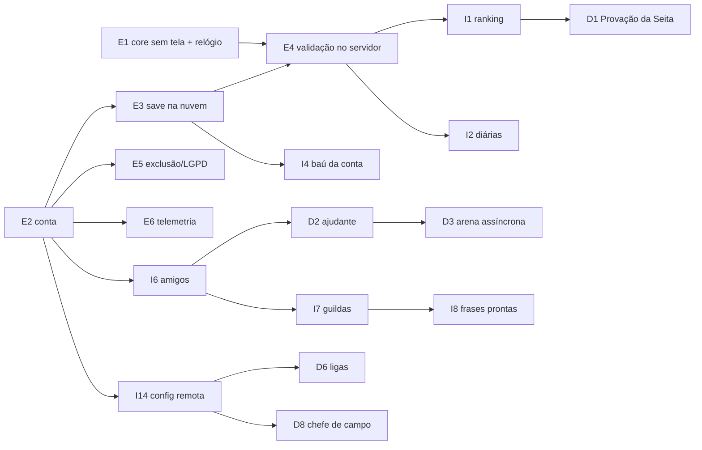

# 03 · Análise de lacunas

> Base: inventário (`01-inventario.md`) e matriz (`02-benchmark.md`). Premissas confirmadas pelo Lucas em 18/11/2026:
> **online assíncrono**, **casual PvE mobile**, **v1 grátis e F2P depois**, **solo dev sem experiência de lançamento, com a IA
> fazendo quase tudo**.
>
> ⚠️ Pela regra do `docs/decisoes/README.md`, **nada aqui está decidido**. Toda funcionalidade que mexe na jogabilidade
> precisa da aprovação do Lucas antes de entrar.

## O que a premissa "solo dev sem experiência + IA faz quase tudo" muda

1. **Nenhum servidor para cuidar.** Só serviços gerenciados (o provedor cuida de atualização, disco, segurança e backup).
   Nada de máquina virtual própria, Docker em produção ou banco hospedado por conta própria.
2. **Evitar sistemas que exigem uma pessoa todo dia.** Chat de texto livre (moderação), economia entre jogadores
   (fraude, inflação, RMT) e suporte manual não escalam para quem joga, desenvolve e opera sozinho. Esses itens foram
   para o pós-lançamento ou ganharam uma versão "sem operação" (frases prontas, guilda NPC).
3. **Tudo como código e documentado**, para qualquer sessão de IA retomar o trabalho: migrações do banco no repositório,
   scripts de deploy, manual de incidentes escrito como passo a passo que a IA executa com o Lucas.
4. **Começar a loja com folga.** Conta na Play, verificação de identidade e teste fechado de 14 dias levam tempo de
   calendário e são justamente o que o Lucas nunca fez. O Lucas decidiu (18/11/2026) não antecipar: a trilha da loja
   começa no início do M3, ~5 semanas antes do lançamento (ver `05-guia-lancamento.md`).
5. **Custo fixo baixo e previsível**, com limite de gastos ligado em todo serviço pago.
6. **Cada tarefa diz quem faz** em `04-marcos.md`: 🤖 a IA faz e o Lucas revisa jogando · 🤝 juntos (a IA guia passo a
   passo, o Lucas clica) · 👤 só o Lucas (identidade, pagamento, assinatura de contrato, decisão de jogabilidade).

**Complexidade** (com a IA implementando e o Lucas testando e decidindo; inclui teste e polimento):
**P** = até 3 dias · **M** = 1 a 2 semanas · **G** = 3 a 6 semanas · **GG** = mais de 6 semanas, ou exige outra pessoa/serviço contínuo.

**Classes:**
- **Essencial:** sem ela não é viável como RPG online.
- **Importante:** os jogadores esperam, afeta a retenção.
- **Diferencial:** pode destacar o jogo.
- **Adiar:** não vale o custo agora.

---

## Decisão de arquitetura que vem antes de tudo

O "online assíncrono" muda a pergunta de "como sincronizar 100 jogadores em tempo real" para **"como confiar no
progresso que o cliente envia"**. O Mistpeak tem uma vantagem rara aqui: o `src/core` é **determinístico** (RNG com
semente, passo fixo de 1/60 s) e **não depende do Phaser**. Por isso o servidor pode:

1. **Calcular ele mesmo o que depende de tempo** (ganho offline, mercador, renascimento de chefe) com o relógio do servidor,
   rodando o mesmo `offline.ts`.
2. **Checar a plausibilidade** de cada save enviado (XP/h, ouro/h, nível dos itens × mapa) contra limites tirados do
   **simulador**, que já existe.
3. **Reexecutar desafios competitivos** (ranking) a partir da semente e das entradas, para provar o resultado.

Para um solo dev, isso dá ~80% da segurança de um servidor autoritativo com ~20% do custo.

**Opções de backend** (decidir no M0 com um protótipo curto; nesta premissa só entram serviços **gerenciados**):

| Opção | Prós | Contras |
| --- | --- | --- |
| **Supabase** (Postgres + Auth + Edge Functions em TS/Deno) | Plano grátis generoso; as funções em TS podem importar o `src/core` direto; SQL para a economia (livro-razão) | Ranking, chat e guildas são feitos à mão (tabelas + Realtime) |
| **Nakama** (servidor de jogo open source) | Já vem com contas, armazenamento, ranking, torneios, grupos (guildas), chat, amigos e notificações | **Não recomendado nesta premissa:** hospedar sozinho é operar servidor e banco (atualização, segurança, disco, backup); a nuvem oficial é cara; o runtime JS (goja) pode não aceitar o bundle do core |
| **Firebase** (Auth + Firestore + Functions) | Integração Android fácil; Auth com Google/Apple pronta | Firestore é ruim para economia transacional; risco de custo por leitura |

Recomendação: **Supabase gerenciado**, por causa do TS no servidor, do SQL, do custo e de não haver servidor para
operar. A IA escreve e versiona as migrações do banco e as funções no repositório. O protótipo do M0 serve para confirmar
(Supabase × Firebase), não para abrir mais opções.

> **Atenção ao plano grátis do Supabase:** o projeto grátis é pausado após ~1 semana sem uso e tem backup limitado. Serve
> para desenvolvimento e alpha. Do beta em diante, conte com o plano pago (~US$ 25/mês, com backup diário). Confira os
> valores vigentes antes de assinar.

---

## Essenciais

| # | Funcionalidade | Situação | Justificativa | Dependências técnicas | Compl. | Riscos |
| --- | --- | --- | --- | --- | :-: | --- |
| E1 | **Core rodando "sem tela" + relógio injetável** | Parcial: o core não usa Phaser, mas usa `Date.now()` em 12 pontos e o `i18n` lê `window` | Pré-requisito para o servidor rodar as mesmas regras. Sem isso, a validação vira um segundo código para manter. | Abstração `Clock`; bundle Node na CI | M | Mudar a ordem do RNG e alterar o balanceamento. Mitigação: o simulador tem de dar saída idêntica, como foi feito na C7. |
| E2 | **Conta (convidado + vincular Google/Apple/e-mail)** | Não existe | Sem identidade não há nuvem, ranking nem social. Entrar como convidado mantém o "abre e joga" de hoje. | Backend escolhido; Sign in with Apple quando houver iOS nativo | M | Conta convidado perdida antes de vincular. Mitigação: lembrete para vincular ao chegar no nível 5 e antes de desinstalar. |
| E3 | **Save na nuvem com conflito resolvido** | Não existe (só local) | Resolve o maior motivo de review ruim no celular: "perdi tudo". Dá **progresso cruzado web ↔ Android**, um diferencial. | E2; `saveFormat.ts`/migrações (já existem) | G | Conflito entre dois aparelhos. Regra: o servidor guarda a versão; um envio com versão antiga pergunta qual manter e mostra nível e data de cada uma. |
| E4 | **Tempo e economia validados no servidor** | Não existe | Sem isso, ranking, mercado e compras viram festa de trapaça (relógio adiantado, save editado). | E1, E3; limites gerados pelo `sim:balance` | G | Falso positivo bloqueando jogador honesto. Mitigação: no começo só **marcar**, não bloquear; revisar manualmente. |
| E5 | **Exclusão de conta, privacidade e LGPD** | Política existe, mas só para o report de bug | Obrigatório nas lojas (Google e Apple exigem excluir a conta dentro do app) e por lei. | E2 | P | Esquecer dado em backup. Mitigação: retenção documentada. |
| E6 | **Telemetria mínima com consentimento** | Não existe (decisão de privacidade) | Sem funil e retenção, não dá para saber se o alpha e o beta funcionam. | E2 (ID anônimo); atualizar a política e o Data Safety | P/M | Coletar demais. Mitigação: lista fechada de ~15 eventos, sem PII. |
| E7 | **Backups, logs e alertas do servidor** | Não existe | Online sem backup testado é perda de progresso em massa esperando acontecer. | Backend | P/M | Backup nunca testado. Mitigação: ensaio de restauração a cada marco. |
| E8 | **Loop repetível de fim de jogo** | Parcial: no nível 20 só resta farmar o Abade e forjar | Online assíncrono vive de motivo para voltar. Hoje o jogo "acaba" em ~3 h ativas. | Pode começar antes do backend; o ranking vem depois de E4 | G | Virar grind sem sentido. Mitigação: recompensa cosmética/título e ranking semanal. |
| E9 | **Processo da loja com folga:** conta no Play Console, verificação de identidade e teste fechado (12 testadores por 14 dias) começando no **início do M3**, ~5 semanas antes do lançamento | Não começado. O Lucas decidiu não antecipar (18/11/2026): primeiro criar mais e jogar mais offline. | O Lucas nunca publicou. Essas etapas levam dias ou semanas de calendário, têm regras que mudam e podem dar recusa. Deixar para a semana do lançamento atrasa tudo. | Build AAB assinado (a IA prepara); appId já decidido (`io.github.flushin.mistpeak`) | P (trabalho) / 3–5 sem (calendário) | Verificação demorar; testadores sumirem. Mitigação: convidar 15–20 pessoas. |

## Importantes

| # | Funcionalidade | Situação | Justificativa | Dependências técnicas | Compl. | Riscos |
| --- | --- | --- | --- | --- | :-: | --- |
| I1 | **Ranking** (nível, tempo de chefe, andar da Provação) | Não existe | O social mais barato e que mais engaja num jogo assíncrono. | E2, E4 | P | Topo cheio de trapaceiros. Mitigação: só aceita resultado validado (E4). |
| I2 | **Diárias/semanais + recompensa de login** | Não existe | É o padrão do gênero para hábito diário. Combina com o ganho offline ("volta, coleta, faz 3 tarefas"). | Relógio do servidor (E4) para o reset diário; pode ter versão local antes | M | Virar obrigação (o problema do Lost Ark). Mitigação: 3 tarefas curtas que o Auto também cumpre. |
| I3 | **Conquistas + bestiário/coleções** | Não existe | Barato, dá metas de longo prazo e conversa com "coleção" e ranking. | Eventos do `World` (já existem); save | M | — |
| I4 | **Baú da conta** (compartilhado entre os 4 personagens) | Não existe ("pode vir depois" no doc de decisões) | Padrão do gênero; dá sentido a ter vários personagens. | E3 (no servidor fica simples); dá para fazer local antes | P | Duplicação de item entre aparelhos. Mitigação: só depois do save na nuvem. |
| I5 | **Talentos simples + respec** | Não existe; todos da mesma seita ficam iguais | Escolha de build é padrão e dá rejogabilidade. Proposta enxuta: 1 escolha entre 2 opções a cada 5 níveis. | `skills.json`, `stats.ts`, simulador | M | Quebrar o balanceamento. Mitigação: simulador com cada combinação. |
| I6 | **Amigos** (código de amigo, ver perfil e equipamento, presentear energia/item leve) | Não existe | Base do social assíncrono. | E2 | M | Spam. Mitigação: limite diário. |
| I7 | **Guildas assíncronas** (entrar, doar, chefe semanal com dano somado, loja da guilda) | Não existe | Principal retenção de médio prazo em MMOs mobile. | E2, E4, I6 | G | Guildas mortas com poucos jogadores. Mitigação: entrada automática numa "guilda da seita" (NPC) até haver guildas de jogadores. |
| I8 | **Comunicação sem moderação:** frases e emojis prontos na guilda e nos amigos ("Bom trabalho!", "Chefe da guilda às 20h"), sem texto livre | Não existe | Dá o mínimo de conversa que o jogador espera **sem exigir moderação humana**. Chat de texto livre foi para o Adiar (A14). | E2, I7 | P/M | Parecer limitado. Mitigação: um Discord da comunidade para conversa livre, moderado por voluntários. |
| I10 | **Missões secundárias repetíveis** ("mural de contratos") | Não existe | Dá variedade ao farm e conteúdo fora da cadeia principal. | `quests.json` (precisa aceitar missões repetíveis) | M | — |
| I11 | **Mais conteúdo de progressão** (nível 20 → 30: 1 mapa, 2 monstros, 1 chefe) | O conteúdo atual dura ~3 h ativas | Precisa haver o que fazer entre o lançamento e a primeira temporada. | Pipeline de arte (o gargalo é haver modelo CC0), gerador de mapas, simulador | G | Arte genérica por falta de modelo (como aconteceu com o Yeti). |
| I12 | **Tutorial interativo** (primeiros 10 min) + medição do funil | Parcial: dicas e primeira missão | Primeira impressão decide a retenção D1 no celular. | E6 | M | — |
| I13 | **Notificações push** (Auto parou, mochila cheia, mercador renovou, chefe da guilda) | Não existe | Reforça o loop de idle; é padrão em jogo mobile. | Capacitor Push + backend (E2) | M | Notificar demais. Mitigação: o jogador escolhe quais. |
| I14 | **Config remota** (feature flags, valores de evento sem lançar versão nova) | Não existe | Pré-requisito para live ops sem esperar a revisão da loja. | Backend | P | — |
| I15 | **Música por zona** (Ruínas, Montanha, chefe) | Parcial (2 faixas) | Custo baixo e grande impacto na sensação de jogo pronto. | CC0/encomenda | P | Licença: seguir o `ASSETS_LICENCAS.md`. |
| I16 | **Viagem rápida** entre mapas visitados | Parcial (só o pergaminho para a vila) | QoL que fica mais importante a cada mapa novo. | `mapsConfig.ts` | P | — |
| I17 | **Acessibilidade** (modo daltônico nas raridades/áreas, reduzir efeitos e tremor) | Parcial | Barato, e as lojas valorizam. | CSS e paletas do `skillFx` | P | — |
| I18 | **Vibração nos golpes** (o `haptics.ts` já existe e não é usado) | Esboço | Sensação de impacto no celular, quase de graça. | `src/platform/haptics.ts` | P | Bateria. Mitigação: opção para desligar. |
| I19 | **Ferramenta de admin mínima** (buscar conta, ver logs, banir, restaurar save) | Não existe | Sem ela, cada ticket de suporte vira acesso direto ao banco. | E2, E3, E7 | M | — |
| I20 | **Documentação operacional para a IA** (`CLAUDE.md` com as regras do projeto, manual de incidentes, como fazer deploy e migração, onde ficam os segredos) | Parcial: o `docs/decisoes/README.md` é ótimo, mas não há `CLAUDE.md` nem manual de operação | Com a IA fazendo quase tudo, cada sessão nova precisa achar o contexto sem o Lucas explicar de novo. Num incidente às 23h, o Lucas abre uma sessão e diz "siga o manual". | Nenhuma | P (contínuo) | Documento desatualizado. Mitigação: atualizar no mesmo PR da mudança (regra já usada no projeto). |

## Diferenciais (oportunidades de destaque)

| # | Funcionalidade | Por que destaca | Dependências técnicas | Compl. | Riscos |
| --- | --- | --- | --- | :-: | --- |
| D1 | **"Provação da Seita": torre de andares solo, com semente semanal igual para todos e ranking verificado por replay** | Usa o core determinístico, que nenhum concorrente indie tem, para um ranking à prova de trapaça. Dá fim de jogo infinito (andar N = monstros escalados) reaproveitando os monstros e arenas que já existem. | E1, E4, I1; um modo de jogo instanciado | G | O replay precisa dar o mesmo resultado no cliente e no servidor (ponto flutuante). Mitigação: testar o replay na CI com o simulador. |
| D2 | **Discípulo emprestado (ajudante assíncrono):** o personagem de um amigo ou membro da guilda acompanha você, controlado pela IA do Auto, e o dono ganha uma recompensa quando é usado | Social sem tempo real. Reaproveita as 733 linhas de `auto.ts`. Lembra os "pawns" do Dragon's Dogma, pouco visto em ARPG mobile. | E3 (snapshot do personagem), I6 | M/G | Balancear a força do ajudante. |
| D3 | **Arena assíncrona** (duelo contra o "fantasma" de outro jogador, controlado pela IA) | PvP sem latência nem servidor de tempo real, padrão em RPG mobile e barato aqui. | D2 (mesma base), I1 | M | Balanceamento PvP entre seitas. |
| D4 | **Progresso justo e transparente** (offline com as taxas mostradas, forja que não destrói item, nada de poder à venda) | Posicionamento contra a frustração de RO, BDO e MS. Pode ser uma mensagem de marketing. | Já existe na maior parte; manter na monetização | P | Pressão para "vender poder" depois. Mitigação: regra escrita no doc de decisões. |
| D5 | **Web + Android com a mesma conta, sem instalar nada na web** | Só OSRS e Albion fazem cross-play mobile, e nenhum roda no navegador: link no Discord ou WhatsApp e já está jogando. | E3 | — (vem de E3) | — |
| D6 | **Ligas sazonais "Rio e Lago"** (personagem novo por temporada, ranking próprio, cosmético exclusivo no fim) | Modelo do OSRS Leagues e do PoE; combina com idle e renova o interesse a cada 2–3 meses. | E4, I1, I14 | G | Dividir uma base pequena de jogadores. Mitigação: só quando houver uns 1.000+ ativos por semana. |
| D7 | **Ranking e torneio por seita** ("qual seita domina a semana") | Identidade wuxia e senso de pertencimento sem guerra de guildas. | I1 | P | — |
| D8 | **Chefe de campo com hora marcada** (mundo "compartilhado" leve: todos enfrentam o mesmo chefe na mesma hora, cada um na sua instância, e o dano total libera uma recompensa global) | Sensação de evento coletivo, sem servidor de tempo real. | E4, I14 | M | — |

## Dispensáveis / adiar

| # | Funcionalidade | Por que adiar | Compl. | Quando reconsiderar |
| --- | --- | :-: | --- | --- |
| A1 | **Mundo compartilhado em tempo real (MMO)** | Decisão: online assíncrono. Exige servidor autoritativo em tempo real, interesse por área e netcode. Custo enorme para um solo dev. | GG | Só se o jogo tiver tração comprovada (por exemplo, 10 mil+ jogadores ativos por mês) e verba para equipe. |
| A2 | **PvP em tempo real / guerra de guildas territorial** | Depende de A1 e foge do público casual PvE. | GG | Depois de A1. A arena assíncrona (D3) cobre a vontade de PvP. |
| A3 | **Raids/dungeons co-op em tempo real** | Depende de netcode. O ajudante assíncrono (D2) entrega parte da sensação. | GG | Depois de A1. |
| A4 | **Housing** | Caro em arte e UI, e pouco ligado ao loop de idle. | G | Pós-lançamento, se os dados mostrarem demanda por cosméticos. Uma versão barata seria o "pátio da seita" decorável. |
| A5 | **Montarias** | Mapas de 32×32 não pedem montaria. | M | Quando houver mapas grandes. |
| A6 | **Ciclo dia/noite e clima** | Bonito, mas não retém. Uma versão barata seria um tom de cor por hora e neve na Montanha. | P (só cor) / M (com efeitos) | Pode entrar como polimento barato no M4. |
| A7 | **Profissões de coleta** (minerar, ervas, pesca) | Duplica o loop de materiais da forja e pede arte e UI novas. | G | Pós-lançamento, como mais uma atividade idle. |
| A8 | **Troca direta entre jogadores** | Principal vetor de RMT e golpes, e exige a mesma vigilância do mercado (A15). | M | Talvez nunca. Se vier, só entre amigos e com limite. |
| A9 | **Battle pass** | Exige conteúdo sazonal constante. Antes disso, vira vitrine vazia. | M | M5, junto das temporadas (D6). |
| A10 | **App iOS nativo** | O Lucas usa Windows; seria preciso um runner macOS na CI e a conta Apple (US$ 99/ano). O iOS pode jogar pela PWA. | M | Depois do lançamento na Play Store, se houver demanda. |
| A11 | **Aparência customizável completa** | O pipeline de sprites recolore modelos CC0. Rosto e corpo customizáveis multiplicam as folhas de sprite. | G | Versão barata no M3/M5: **2–3 paletas de cor por seita** (recolor), que já vira cosmético. |
| A12 | **Remapeamento de teclas** | O público principal é mobile. | P | Quando houver demanda do PC. |
| A13 | **Trocar de seita no mesmo personagem** (estilo FF14) | Muda a estrutura do save e o balanceamento. Os 4 espaços de personagem já resolvem. | G | Pós-lançamento. |
| A14 | **Chat de texto livre** (global ou de guilda) | Exige moderação humana contínua (assédio, golpes, RMT, conteúdo ilegal) e obrigações de denúncia nas lojas. Inviável para um solo dev que também desenvolve. | M (código) / contínuo (moderação) | Quando houver moderadores voluntários ou orçamento para um serviço de moderação. |
| A15 | **Mercado entre jogadores** (mesmo só de materiais) | Precisa de vigilância contínua da economia (bots, inflação, duplicação, RMT). Um erro vira problema público no dia seguinte. | G | Pós-lançamento (M5), com o livro-razão do servidor rodando há meses e alertas automáticos de anomalia. |

---

## Mapa de dependências (resumo)

## Prioridade cruzada (valor × custo)

| | Custo baixo (P/M) | Custo alto (G/GG) |
| --- | --- | --- |
| **Valor alto** | E1, E2, E5, E6, E7, E9, I1, I2, I3, I14, I15, I18, I20 | E3, E4, E8/D1, I7, I11 |
| **Valor médio** | I4, I5, I6, I8, I10, I12, I13, I16, I17, I19, D3, D7 | D2, D6 |
| **Valor baixo agora** | A6, A12 | A1, A2, A3, A4, A7, A13, A14, A15 |
