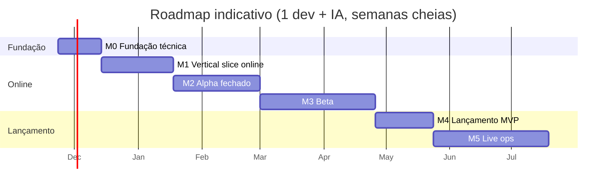

# 04 · Roadmap por marcos

> **Nomes:** para não confundir com os Marcos 1–9 do `docs/decisoes-do-projeto.md` (já concluídos), este roadmap usa
> **M0 a M5+**. O antigo "Marco 10: online" está distribuído entre o M0, o M1 e o M3.
>
> **Ponto de partida:** o Mistpeak já é um **jogo single-player completo** do nível 1 ao 20 (4 seitas, 4 mapas, 2 chefes,
> forja, mercador, Auto e offline), com testes e app Android. Por isso o "protótipo jogável" clássico já existe, e o M1
> aqui é o **vertical slice online**: o primeiro pedaço do jogo funcionando de ponta a ponta com conta e servidor.
>
> **Esforço:** em semanas de trabalho focado de 1 pessoa com apoio de IA. Os Marcos 1–9 andaram muito rápido (dias) porque
> eram código e conteúdo. A partir daqui, parte do tempo é **de calendário** e não acelera com IA: testers jogando,
> revisão das lojas, teste fechado da Play (12 testadores por 14 dias), operação de servidor.
>
> **Regra da casa:** cada item que muda a jogabilidade passa por pergunta de múltipla escolha ao Lucas antes de ser feito.
> Os códigos (E1, I2, D1…) remetem a `03-lacunas.md`.

---

## M0 · Fundação técnica para o online

**Objetivo:** deixar o core pronto para rodar no servidor e escolher o backend, sem mudar nada no jogo.

**Pronto quando:** um teste na CI carrega um save, aplica o ganho offline com um relógio "de servidor" injetado e dá
**exatamente** o mesmo resultado que o navegador. O backend foi escolhido e a decisão está registrada.

**Esforço:** 2 a 3 semanas.

**Funcionalidades** (em ordem de dependência):
- [ ] **E1a** Relógio injetável (`Clock`) no core: trocar os 12 `Date.now()` (offline, mercador, renascimentos, saves) por `world.clock.now()`
- [ ] **E1b** `i18n` sem `window` no core (o idioma entra por parâmetro) para o core rodar em Node
- [ ] **E1c** Bundle "headless" do core (esbuild, plataforma Node) e teste `check:headless` na CI
- [ ] **E1d** Registro de eventos econômicos no `World` (XP, ouro, drops, forja, compras), para auditoria no servidor
- [ ] **E4a** Gerar `plausibility.json` a partir do `sim:balance` (XP/h, ouro/h e nível de item máximos por nível de personagem e mapa, com folga)
- [ ] `uid` de itens à prova de servidor: hoje o `newUid()` (`src/core/items.ts:149`) usa `Date.now()`, um contador e
      `Math.random()` fora do RNG com semente. É quase único, mas não é reproduzível num replay nem garantido entre aparelhos.
      Passar para o `Clock` e o RNG, com prefixo por aparelho ou conta.
- [ ] `navigator.storage.persist()` na web (protege o save local até a nuvem existir)
- [ ] Incluir `tools/*.ts` num `tsconfig` próprio para os testes passarem pelo `tsc`
- [ ] Protótipo de backend (2 dias cada): Supabase × Nakama, cada um com login convidado, salvar/ler JSON e uma função TS importando o core
- [ ] Registrar a decisão de backend e o modelo de dados inicial (contas, personagens, saves, livro-razão) no doc de decisões
- [ ] Decidir o **nome final e o appId**. Fecha a pendência antes de qualquer conta real existir.

**Métrica de validação:**
- `check:headless` verde na CI
- 0 usos de `Date.now()` no `src/core` fora do `Clock`
- `sim:balance` com **saída idêntica** antes e depois (a mesma régua da refatoração C7)

**Riscos:**
- A refatoração do relógio mudar o balanceamento sem querer. Mitigação: a comparação do simulador.
- Escolher o backend pela moda. Mitigação: o protótipo com o mesmo roteiro nas duas opções.

---

## M1 · Vertical slice online

**Objetivo:** o jogo atual, sem conteúdo novo, passa a ter conta, save na nuvem, relógio do servidor e um primeiro ranking.
Joga-se com o mesmo progresso no PC e no Android.

**Pronto quando:** 10 amigos jogam por 7 dias, trocando de aparelho, sem perder progresso. O ranking não mostra nenhum
resultado impossível.

**Esforço:** 3 a 5 semanas.

**Funcionalidades:**
- [ ] **E2** Conta convidado automática na primeira abertura (o jogador não vê tela de login)
- [ ] **E2** Vincular a conta a Google (Android/web) e e-mail, com lembrete no nível 5 e na tela de configurações
- [ ] **E3a** Migração única: na primeira vez, os 4 espaços locais sobem para a conta
- [ ] **E3b** Salvamento na nuvem (a cada 30 s com mudança, ao pausar e ao trocar de mapa), com versão e checksum; o local vira cache
- [ ] **E3c** Tela de conflito ("Este aparelho: nv 14, ontem · Nuvem: nv 16, hoje — qual manter?")
- [ ] **E3d** Jogar sem internet: continua local e sincroniza quando voltar (o offline é calculado pelo servidor ao reconectar)
- [ ] **E4b** O servidor calcula o ganho offline e o estoque do mercador com o relógio dele
- [ ] **E4c** Verificação de plausibilidade a cada envio. No início só **marca** a conta suspeita, sem bloquear.
- [ ] **I1a** Ranking 1: maior nível por seita e menor tempo contra o General e o Abade (só com resultados validados)
- [ ] **E5** Excluir conta dentro do app; política de privacidade e Data Safety atualizados (conta, save e telemetria)
- [ ] **E6** Telemetria mínima com consentimento (~15 eventos: abrir, criar personagem, missão N, nível N, morte, chefe, Auto, offline, sessão)
- [ ] Reportar bug passa pelo backend (sai do Web3Forms; acaba o risco da cota)
- [ ] **E7** Backup diário automático, logs de erro do servidor e alerta por e-mail
- [ ] **E7** Primeiro **ensaio de restauração** do backup, cronometrado

**Métricas de validação:**
- 0 saves perdidos em 7 dias com 10 jogadores
- Sincronização p95 < 2 s
- 100% dos saves com checksum válido
- 0 entradas impossíveis no ranking
- Restauração do backup em menos de 1 h
- Retenção D1 medida (sem meta ainda: é o primeiro número de referência)

**Riscos:**
- Conflito de save mal resolvido apagar progresso. Mitigação: o servidor guarda as 5 últimas versões por personagem.
- Custo do backend. Mitigação: plano grátis com alerta de uso a 70%.
- LGPD. Mitigação: só coletar o necessário e manter a política alinhada.

---

## M2 · Alpha fechado

**Objetivo:** criar o **loop de retenção** (motivo para voltar todo dia e toda semana) e o social mais leve, e medir com
30 a 50 testers.

**Pronto quando:** o alpha roda 2 semanas com 30+ testers, o funil está medido e há uma lista priorizada do que corrigir.

**Esforço:** 4 a 6 semanas.

**Funcionalidades:**
- [ ] **I14** Config remota (flags e valores) para ligar e desligar sistemas e eventos sem lançar versão
- [ ] **I2a** Recompensa de login de 7 dias (ciclo)
- [ ] **I2b** 3 tarefas diárias + 1 semanal (cumpríveis também com o Auto), com reset pelo relógio do servidor
- [ ] **I3** Conquistas (~30) e bestiário (contagem de abates por monstro, com recompensa por marco)
- [ ] **D1** **Provação da Seita** (torre solo): andares com monstros escalados, semente semanal igual para todos
- [ ] **D1/I1b** Ranking semanal da Provação **verificado por replay** no servidor
- [ ] **I5** Talentos simples (1 escolha entre 2 a cada 5 níveis) + respec com ouro, balanceados no simulador
- [ ] **I4** Baú da conta (compartilhado entre os 4 personagens)
- [ ] **I6** Amigos: código de amigo, ver perfil e equipamento
- [ ] **I12** Tutorial interativo dos primeiros 10 minutos, com eventos de funil
- [ ] **I15** Música das Ruínas, da Montanha e de luta contra chefe
- [ ] **I16** Viagem rápida entre mapas visitados (no portal da vila)
- [ ] **I18** Vibração nos golpes, críticos e subida de nível (com opção para desligar)
- [ ] Canal de feedback do alpha (Discord ou formulário) e roteiro de teste para os testers

**Métricas de validação** (referências típicas de RPG mobile casual, a ajustar com os dados):
- Tutorial concluído por ≥ 70% de quem começa
- D1 ≥ 35% e D7 ≥ 12% entre os testers
- Sessões sem crash ≥ 99%
- ≥ 50% dos testers ativos chegam à Provação
- 0 duplicação de item ou ouro detectada pela auditoria de eventos

**Riscos:**
- Amostra pequena gerar métricas enganosas. Mitigação: olhar o funil (onde param), mais do que a porcentagem.
- Diárias virarem obrigação. Mitigação: as tarefas não exigem jogo ativo.
- Talentos desbalancearem as seitas. Mitigação: o simulador roda cada combinação.

---

## M3 · Beta

**Objetivo:** social assíncrono completo, economia entre jogadores (limitada) e conteúdo até o nível 30. Testar carga e a
operação com centenas de jogadores. Inclui o **teste fechado obrigatório da Play Store**.

**Pronto quando:** 200 a 500 beta testers por 3+ semanas, o backend aguenta 500 jogadores simulados com folga e a
economia fecha no livro-razão (todo ouro e material tem origem registrada).

**Esforço:** 6 a 8 semanas. O teste fechado da Play (12+ testadores por 14 dias) corre em paralelo.

**Funcionalidades:**
- [ ] **I7a** Guildas: criar/entrar/sair, cargos simples, guilda NPC da seita para quem não tem guilda
- [ ] **I7b** Chefe semanal da guilda (dano somado de todos, recompensas por faixa)
- [ ] **I7c** Doações e loja da guilda
- [ ] **I8** Chat da guilda com filtro, denúncia e bloqueio; no global, só mensagens rápidas prontas
- [ ] **D2** Discípulo emprestado: levar o personagem de um amigo ou membro da guilda como ajudante (IA do Auto)
- [ ] **I9** Mercado de **materiais** pelo servidor, com taxa, limites diários e livro-razão
- [ ] **I11** Conteúdo do nível 20 ao 30: 1 mapa, 2 monstros, 1 chefe, bases nv 20/25 e missões da cadeia
- [ ] **I10** Mural de contratos (missões secundárias repetíveis)
- [ ] **I13** Notificações push (Auto parou, mochila cheia, mercador renovou, chefe da guilda) com escolha do jogador
- [ ] **I17** Acessibilidade: modo daltônico (raridades e áreas marcadas no chão) e "reduzir efeitos"
- [ ] **I19** Ferramenta de admin: buscar conta, ver eventos, marcar e banir, restaurar save de uma versão anterior
- [ ] **E4d** Verificação de plausibilidade passa a **bloquear** casos claros (com caminho de recurso pelo report)
- [ ] Teste de carga: 500 bots headless (o core em Node) jogando contra o backend
- [ ] Play Store: conta, verificação de identidade, chave de assinatura, teste fechado (12+ testadores por 14 dias)

**Métricas de validação:**
- D7 ≥ 15% e D30 medido
- Backend p95 < 300 ms com 500 bots e custo projetado para 5 mil jogadores ativos por mês dentro do orçamento definido
- Livro-razão reconcilia 100%: ouro e materiais criados = gastos + saldo
- 0 incidente de moderação sem resposta em 48 h
- ≥ 30% dos testers ativos numa guilda de jogadores

**Riscos:**
- **Moderação de chat** consumir o tempo do solo dev. Mitigação: o global só com frases prontas, filtro forte, a guilda modera a guilda.
- **Economia** inflar com o mercado. Mitigação: taxa que retira ouro, só materiais, limites diários e config remota para ajustar.
- **Arte do nível 20–30** sem modelo CC0 adequado. Mitigação: escolher o tema do mapa pelos modelos disponíveis.
- Base de testers pequena deixar as guildas vazias. Mitigação: a guilda NPC da seita.

---

## M4 · Lançamento (MVP)

**Objetivo:** publicar na Play Store e na web com operação estável, **sem monetização** (como decidido para a v1).

**Pronto quando:** o jogo está publicado e passa 2 semanas sem incidente P0 (perda de progresso, servidor fora do ar
mais de 1 h, exploit de economia) com os primeiros ~1.000 jogadores.

**Esforço:** 3 a 4 semanas, mais o tempo de revisão da loja.

**Funcionalidades:**
- [ ] Pendências de loja: e-mail do jogo, busca de marca, imagens e vídeo da loja (o `tools/trailer/` já existe), IARC, revisão das licenças
- [ ] Textos PT/EN revisados por alguém fluente (loja, tutorial, missões)
- [ ] Polimento barato: tom de cor por hora do dia e neve caindo na Montanha (**A6**, versão P), se sobrar tempo
- [ ] Manual de incidentes (servidor fora, save corrompido, exploit encontrado), com passos e contatos
- [ ] Monitoramento: disponibilidade, erros, custo, fila de reports; alerta no celular
- [ ] Segundo ensaio de restauração do backup (agora com o volume do beta)
- [ ] Página/servidor de comunidade (Discord) com regras e canal de bugs
- [ ] Plano de comunicação do lançamento (data, posts, trailer)
- [ ] Lista dos primeiros 3 eventos de live ops já configurados na config remota

**Métricas de validação:**
- Sessões sem crash ≥ 99,5% no Android Vitals
- ANR < 0,47% (limite de "mau comportamento" da Play)
- 0 incidente P0 em 2 semanas
- Nota na loja ≥ 4,2
- D1, D7 e D30 da coorte de lançamento registrados para comparar com o beta

**Riscos:**
- Pico de jogadores no lançamento estourar o plano do backend. Mitigação: o teste de carga do M3 e um limite de gastos.
- Review ruim por bug de primeira sessão. Mitigação: lançamento escalonado na Play (10% → 50% → 100%).

---

## M5+ · Pós-lançamento e live ops

**Objetivo:** cadência de conteúdo e eventos e **monetização ética** (sem vender poder), conforme a decisão de "F2P depois".

**Pronto quando:** cada ciclo trimestral entrega pelo menos 1 evento sazonal, 1 atualização de conteúdo e a receita cobre
o custo do servidor.

**Esforço:** contínuo; cada bloco abaixo leva de 2 a 6 semanas.

**M5a · Monetização ética**
- [ ] Decisão com o Lucas: o que vender (cosméticos, conveniência leve) e o que **nunca** vender (poder, chance na forja). Registrar no doc de decisões.
- [ ] Anúncio com recompensa opcional (por exemplo, dobrar o ganho offline uma vez por dia), com consentimento UMP
- [ ] Moeda premium (diamantes) com **compra validada no servidor** (Google Play Billing) e livro-razão separado
- [ ] Cosméticos: 2 a 3 paletas de roupa por seita (recolor no pipeline de sprites, versão barata da **A11**), efeitos de skill alternativos, títulos
- [ ] Atualizar política, Data Safety e classificação indicativa (anúncios e compras)

**M5b · Retenção de longo prazo**
- [ ] Eventos sazonais pela config remota (Ano Novo Lunar, Festival do Meio do Outono…) com missões e cosméticos de evento
- [ ] **D3** Arena assíncrona (duelo contra o "fantasma" de outro jogador) com ranking semanal
- [ ] **D7** Ranking e torneio semanal por seita
- [ ] **D8** Chefe de campo com hora marcada (dano global somado)
- [ ] Passe de temporada (grátis + premium **só cosmético**), quando houver eventos regulares (**A9**)
- [ ] **D6** Ligas sazonais, quando houver uns 1.000+ jogadores ativos por semana

**M5c · Conteúdo e plataformas**
- [ ] Nova seita por temporada maior (o mesmo processo do Marco 8: skills aprovadas, sprite, simulador)
- [ ] Mercado de equipamentos, se a economia de materiais se mostrar saudável
- [ ] App iOS nativo (**A10**), se a PWA no iPhone gerar demanda
- [ ] Profissões de coleta idle (**A7**) e o "pátio da seita" decorável (**A4**, versão barata), se os dados pedirem

**Métricas de validação:**
- D30 ≥ 5%
- Conversão para pagante de 1 a 3% (referência de F2P casual)
- Receita mensal ≥ custo do servidor + ferramentas
- Cadência: ≥ 1 evento por mês
- Nenhuma reclamação recorrente de "pay to win" nas reviews

**Riscos:**
- Esgotamento do solo dev com a cadência de live ops. Mitigação: eventos reaproveitam sistemas (config remota + missões + cosméticos recoloridos).
- Pressão para vender poder. Mitigação: a regra escrita no M5a.

---

## Visão geral

| Marco | Foco | Esforço (1 dev + IA) | Validação principal |
| --- | --- | --- | --- |
| **M0** | Core no servidor, relógio, escolha do backend | 2–3 sem | Saída idêntica Node × navegador; simulador idêntico |
| **M1** | Conta, nuvem, relógio do servidor, 1º ranking | 3–5 sem | 10 amigos × 7 dias, 0 save perdido |
| **M2** | Diárias, conquistas, Provação, talentos, amigos | 4–6 sem | 30+ testers, D1 ≥ 35%, D7 ≥ 12% |
| **M3** | Guildas, chat, ajudante, mercado de materiais, nv 30 | 6–8 sem | 500 bots p95 < 300 ms, livro-razão 100% |
| **M4** | Loja, operação, lançamento | 3–4 sem | 2 semanas sem P0, crash-free ≥ 99,5% |
| **M5+** | Monetização ética, eventos, temporadas | Contínuo | D30 ≥ 5%, receita ≥ custo |

**Total até o lançamento:** ~18 a 26 semanas de trabalho focado (~4 a 6 meses), mais o tempo de calendário dos testes
e das lojas.

