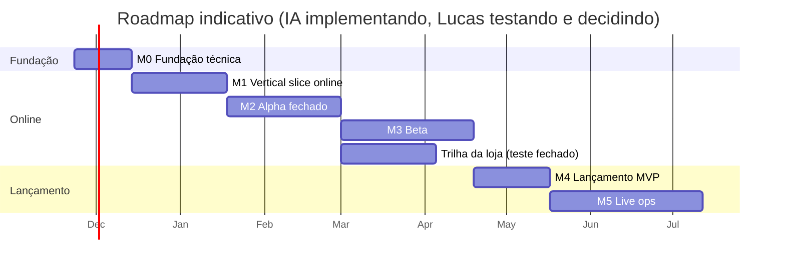

# 04 · Roadmap por marcos

> **Premissa:** o Lucas é solo dev, **sem experiência de lançar jogos ou apps nas lojas**, e a IA faz quase tudo. Por isso
> cada tarefa diz quem faz, os marcos evitam sistemas que exigem operação humana diária, e a parte de loja começa cedo
> (detalhada em `05-guia-lancamento.md`).
>
> **Nomes:** para não confundir com os Marcos 1–9 do `docs/decisoes/README.md` (já concluídos), este roadmap usa
> **M0 a M5+**. O antigo "Marco 10: online" está distribuído entre o M0, o M1 e o M3.
>
> **Regra da casa:** cada item que muda a jogabilidade passa por pergunta de múltipla escolha ao Lucas antes de ser feito.
> Os códigos (E1, I2, D1…) remetem a `03-lacunas.md`.

## Quem faz

| Marca | Significado |
| --- | --- |
| 🤖 | **A IA faz.** Escreve o código, os testes e a documentação e abre o PR. O Lucas revisa **jogando** (não precisa ler código) e aprova o merge. |
| 🤝 | **Juntos.** A IA prepara tudo e guia passo a passo (o que clicar, o que preencher, o que conferir); o Lucas executa na conta dele. |
| 👤 | **Só o Lucas.** Exige identidade, pagamento, assinatura, conta pessoal ou uma decisão de jogabilidade ou de negócio. |

## Como trabalhar com a IA em cada tarefa

1. Abrir uma sessão e pedir pelo código da tarefa (por exemplo, "faça o E1a do roadmap").
2. A IA pergunta o que for decisão de jogabilidade (múltipla escolha), implementa num PR pequeno e roda os testes, o
   simulador e o `check:layout` quando a interface muda.
3. A IA escreve no PR **o que testar jogando** (roteiro de 5 minutos). O Lucas joga o APK da CI ou o site de teste e responde
   "ok" ou "achei isso".
4. Merge, registro da decisão em `docs/decisoes/README.md` e a caixa marcada aqui.

**Esforço:** as semanas são de calendário, com a IA implementando. O gargalo passa a ser o **tempo do Lucas** para testar
e decidir, e as esperas que ninguém acelera: verificação de identidade, teste fechado da Play (14 dias), revisão da loja
e testers jogando. Cada marco traz uma estimativa de horas por semana do Lucas.

---

## Trilha C · Conteúdo e polimento offline (pode começar agora)

O Lucas quer **criar mais e jogar mais offline antes da loja** (18/11/2026). Estes itens **não dependem do servidor**:
podem ser feitos antes do M0, em paralelo a qualquer marco ou intercalados, no ritmo que o Lucas quiser. Quando um deles
aparece também num marco abaixo, vale o que for feito primeiro (marque nos dois lugares).

- [ ] 👤 **Escolher a ordem** (a IA propõe em múltipla escolha a cada rodada)
- [ ] 🤖 **I15** Música das Ruínas, da Montanha e de luta contra chefe; 👤 aprovar ouvindo
- [ ] 🤖 **I18** Vibração nos golpes, críticos e subida de nível
- [ ] 🤖 **I16** Viagem rápida entre mapas visitados
- [ ] 🤖 **I5** Talentos (2 opções a cada 5 níveis) + respec, depois que o 👤 aprovar as propostas simuladas
- [ ] 🤖 **I3** Conquistas e bestiário (versão local; sincronizam quando houver conta)
- [ ] 🤖 **I10** Mural de contratos (missões secundárias repetíveis)
- [ ] 🤖 **D1** Provação da Seita, versão local (andares e recompensas; o ranking verificado entra no M2)
- [ ] 🤖 **I11** Conteúdo do nível 20 ao 30 (mapa, monstros, chefe, equipamentos, missões); 👤 escolher o tema
- [ ] 🤖 **I12** Tutorial interativo dos primeiros 10 minutos
- [ ] 🤖 **I17** Acessibilidade (modo daltônico, reduzir efeitos)
- [ ] 🤖 **A6** Tom de cor por hora do dia e neve caindo na Montanha
- [ ] 🤖 **I4** Baú da conta, versão local (compartilhado entre os 4 personagens do aparelho)

**Cuidado:** cada mês de conteúdo offline adia o online na mesma medida. O risco de perder o save (só no aparelho) continua
até o M1. O `navigator.storage.persist()` (item do M0) é barato e pode vir antes, para proteger quem testa.

---

## M0 · Fundação técnica

**Objetivo:** deixar o core pronto para rodar no servidor e escolher o backend, sem mudar nada no jogo. A loja fica para
o M3 (decidido pelo Lucas em 18/11/2026: primeiro criar mais e jogar mais offline).

**Pronto quando:**
- um teste na CI carrega um save, aplica o ganho offline com um relógio "de servidor" injetado e dá **exatamente** o mesmo
  resultado que o navegador;
- o backend está escolhido e registrado.

**Esforço:** 2 a 3 semanas. **Tempo do Lucas:** ~5 h/semana (testar e decidir), mais ~1 h para criar a conta no Supabase.

**Código e arquitetura:**
- [ ] 🤖 **I20** `CLAUDE.md` com as regras do projeto (decisões, múltipla escolha, testes, como rodar), para qualquer sessão de IA começar sabendo o contexto
- [ ] 🤖 **E1a** Relógio injetável (`Clock`) no core: trocar os 12 `Date.now()` (offline, mercador, renascimentos, saves, `newUid`) por `world.clock.now()`
- [ ] 🤖 **E1b** `i18n` sem `window` no core (o idioma entra por parâmetro) para o core rodar em Node
- [ ] 🤖 **E1c** Bundle "headless" do core (esbuild, plataforma Node) e teste `check:headless` na CI
- [ ] 🤖 **E1d** Registro de eventos econômicos no `World` (XP, ouro, drops, forja, compras), para auditoria no servidor
- [ ] 🤖 **E4a** Gerar `plausibility.json` a partir do `sim:balance` (XP/h, ouro/h e nível de item máximos por nível e mapa, com folga)
- [ ] 🤖 `uid` de itens à prova de servidor. Hoje o `newUid()` (`src/core/items.ts:149`) usa `Date.now()`, um contador e
      `Math.random()` fora do RNG com semente; passar para o `Clock` e o RNG, com prefixo por aparelho ou conta.
- [ ] 🤖 `navigator.storage.persist()` na web (protege o save local até a nuvem existir)
- [ ] 🤖 Incluir `tools/*.ts` num `tsconfig` próprio para os testes passarem pelo `tsc`
- [ ] 🤝 Criar a conta no Supabase (grátis), com a IA guiando, e guardar as chaves no lugar certo (nunca no repositório)
- [ ] 🤖 Protótipo do backend: login convidado, salvar/ler o save e uma função TS importando o core, em Supabase e, para comparar, Firebase
- [ ] 👤 Escolher o backend com base no relatório do protótipo (múltipla escolha); a IA registra a decisão e o modelo de dados

**Métricas de validação:**
- `check:headless` verde na CI
- 0 usos de `Date.now()` no `src/core` fora do `Clock`
- `sim:balance` com **saída idêntica** antes e depois (a mesma régua da refatoração C7)

**Riscos:**
- A refatoração do relógio mudar o balanceamento sem querer. Mitigação: a comparação do simulador.

---

## M1 · Vertical slice online

**Objetivo:** o jogo atual, sem conteúdo novo, passa a ter conta, save na nuvem, relógio do servidor e um primeiro ranking.
Joga-se com o mesmo progresso no PC e no Android.

**Pronto quando:** 10 amigos jogam por 7 dias, trocando de aparelho, sem perder progresso. O ranking não mostra nenhum
resultado impossível.

**Esforço:** 3 a 5 semanas. **Tempo do Lucas:** ~5–8 h/semana (testar em 2 aparelhos, trocar de aparelho de propósito, decidir).

**Funcionalidades:**
- [ ] 🤖 **E2** Conta convidado automática na primeira abertura (o jogador não vê tela de login)
- [ ] 🤖 **E2** Vincular a conta a Google e e-mail, com lembrete no nível 5 e na tela de configurações
- [ ] 🤝 Configurar o login com Google nos consoles do Google e do Supabase (a IA guia, o Lucas cola as chaves)
- [ ] 🤖 **E3a** Migração única: na primeira vez, os 4 espaços locais sobem para a conta
- [ ] 🤖 **E3b** Salvamento na nuvem (a cada 30 s com mudança, ao pausar e ao trocar de mapa), com versão e checksum; o local vira cache
- [ ] 👤 **Decidir** a regra da tela de conflito (proposta: mostrar nível e data das duas versões e o jogador escolhe)
- [ ] 🤖 **E3c** Tela de conflito e histórico das 5 últimas versões por personagem no servidor
- [ ] 🤖 **E3d** Jogar sem internet: continua local e sincroniza quando voltar (o offline é calculado pelo servidor ao reconectar)
- [ ] 🤖 **E4b** O servidor calcula o ganho offline e o estoque do mercador com o relógio dele
- [ ] 🤖 **E4c** Verificação de plausibilidade a cada envio. No início só **marca** a conta suspeita, sem bloquear.
- [ ] 🤖 **I1a** Ranking 1: maior nível por seita e menor tempo contra o General e o Abade (só com resultados validados)
- [ ] 🤖 **E5** Excluir conta dentro do app **e** por uma página web (a Play exige as duas); política e Data Safety atualizados
- [ ] 👤 **Decidir** a lista de eventos de telemetria (a IA propõe ~15, sem dado pessoal)
- [ ] 🤖 **E6** Telemetria mínima com consentimento e um painel simples com funil e retenção (o Lucas só lê)
- [ ] 🤖 Reportar bug passa pelo backend (sai do Web3Forms; acaba o risco da cota)
- [ ] 🤖 **E7** Backup automático, logs de erro e alerta por e-mail; 🤝 ligar o limite de gastos no Supabase
- [ ] 🤝 **E7** Primeiro **ensaio de restauração** do backup, seguindo o manual que a IA escreveu, cronometrado
- [ ] 🤖 **I20** Manual de incidentes v1 ("save sumiu", "servidor fora", "conta suspeita"), escrito para o Lucas pedir à IA "siga o manual"

**Métricas de validação:**
- 0 saves perdidos em 7 dias com 10 jogadores
- Sincronização p95 < 2 s
- 100% dos saves com checksum válido
- 0 entradas impossíveis no ranking
- Restauração do backup em menos de 1 h, feita pelo Lucas com a IA, sem improviso
- Retenção D1 medida (sem meta ainda: é o primeiro número de referência)

**Riscos:**
- Conflito de save mal resolvido apagar progresso. Mitigação: as 5 versões guardadas e a restauração pelo manual.
- Chave secreta parar no repositório por engano. Mitigação: a IA configura a varredura de segredos na CI.
- LGPD. Mitigação: só coletar o necessário e manter a política alinhada (🤖 redige, 👤 aprova).

---

## M2 · Alpha fechado

**Objetivo:** criar o **loop de retenção** (motivo para voltar todo dia e toda semana) e o social mais leve, e medir com
30 a 50 testers (amigos e conhecidos, pelo site e pelo APK de teste da CI; ainda sem loja).

**Pronto quando:** o alpha roda 2 semanas com 30+ testers, o funil está medido e há uma lista priorizada do que corrigir
(a IA monta a lista a partir dos dados e dos reports).

**Esforço:** 4 a 6 semanas. **Tempo do Lucas:** ~8 h/semana (jogar, responder testers, decidir o design de cada sistema).

**Funcionalidades:**
- [ ] 🤖 **I14** Config remota (flags e valores) para ligar e desligar sistemas e eventos sem lançar versão
- [ ] 👤 **Decidir** recompensas de login, tarefas diárias e conquistas (a IA propõe em múltipla escolha)
- [ ] 🤖 **I2a** Recompensa de login de 7 dias (ciclo)
- [ ] 🤖 **I2b** 3 tarefas diárias + 1 semanal (cumpríveis também com o Auto), com reset pelo relógio do servidor
- [ ] 🤖 **I3** Conquistas (~30) e bestiário (contagem de abates por monstro, com recompensa por marco)
- [ ] 👤 **Decidir** o design da Provação da Seita (andares, escala, recompensas)
- [ ] 🤖 **D1** **Provação da Seita** (torre solo): andares com monstros escalados, semente semanal igual para todos
- [ ] 🤖 **D1/I1b** Ranking semanal da Provação **verificado por replay** no servidor
- [ ] 👤 **Decidir** os talentos de cada seita (a IA propõe 2 opções a cada 5 níveis, já testadas no simulador)
- [ ] 🤖 **I5** Talentos + respec com ouro
- [ ] 🤖 **I4** Baú da conta (compartilhado entre os 4 personagens)
- [ ] 🤖 **I6** Amigos: código de amigo, ver perfil e equipamento
- [ ] 🤖 **I12** Tutorial interativo dos primeiros 10 minutos, com eventos de funil
- [ ] 🤖 **I15** Música das Ruínas, da Montanha e de luta contra chefe (CC0, com a licença registrada); 👤 aprovar ouvindo
- [ ] 🤖 **I16** Viagem rápida entre mapas visitados (no portal da vila)
- [ ] 🤖 **I18** Vibração nos golpes, críticos e subida de nível (com opção para desligar)
- [ ] 🤝 Canal de feedback do alpha (servidor no Discord com canais prontos, que a IA descreve) e roteiro de teste para os testers

**Métricas de validação** (referências típicas de RPG mobile casual, a ajustar com os dados):
- Tutorial concluído por ≥ 70% de quem começa
- D1 ≥ 35% e D7 ≥ 12% entre os testers
- Sessões sem crash ≥ 99%
- ≥ 50% dos testers ativos chegam à Provação
- 0 duplicação de item ou ouro detectada pela auditoria de eventos

**Riscos:**
- Amostra pequena gerar métricas enganosas. Mitigação: olhar o funil (onde param), mais do que a porcentagem.
- Diárias virarem obrigação. Mitigação: as tarefas não exigem jogo ativo.
- Excesso de decisões de design travar o marco. Mitigação: a IA traz propostas fechadas e já simuladas, e o Lucas só escolhe.

---

## M3 · Beta

**Objetivo:** social assíncrono **sem operação diária** (guildas, ajudante, frases prontas), conteúdo até o nível 30 e
um teste de carga. **Fora deste marco, de propósito:** chat de texto livre e mercado entre jogadores (A14 e A15), que exigem
moderação e vigilância contínuas.

**Pronto quando:** 200 a 500 beta testers por 3+ semanas, o backend aguenta 500 jogadores simulados com folga e a
economia fecha no livro-razão (todo ouro e material tem origem registrada).

**Esforço:** 5 a 7 semanas. **Tempo do Lucas:** ~8–10 h/semana (jogar o conteúdo novo, aprovar arte, acompanhar a comunidade), mais ~4 h para as contas da loja.

**Funcionalidades:**
- [ ] 👤 Passar o Supabase para o plano pago (backup diário, sem pausa), com limite de gastos
- [ ] 🤖 **I7a** Guildas: criar/entrar/sair, cargos simples, guilda NPC da seita para quem não tem guilda
- [ ] 🤖 **I7b** Chefe semanal da guilda (dano somado de todos, recompensas por faixa)
- [ ] 🤖 **I7c** Doações e loja da guilda
- [ ] 🤖 **I8** Frases e emojis prontos na guilda e entre amigos (sem texto livre, sem moderação)
- [ ] 🤖 **D2** Discípulo emprestado: levar o personagem de um amigo ou membro da guilda como ajudante (IA do Auto)
- [ ] 👤 **Decidir** o tema do mapa do nível 20–30 (a IA lista o que dá para fazer com os modelos CC0 disponíveis)
- [ ] 🤖 **I11** Conteúdo do nível 20 ao 30: 1 mapa, 2 monstros, 1 chefe, bases nv 20/25 e missões da cadeia
- [ ] 🤖 **I10** Mural de contratos (missões secundárias repetíveis)
- [ ] 🤖 **I13** Notificações push (Auto parou, mochila cheia, mercador renovou, chefe da guilda); 🤝 configurar o Firebase Cloud Messaging
- [ ] 🤖 **I17** Acessibilidade: modo daltônico (raridades e áreas marcadas no chão) e "reduzir efeitos"
- [ ] 🤖 **I19** Painel de admin simples (buscar conta, ver eventos, marcar e banir, restaurar save), para o Lucas atender suporte sem mexer no banco
- [ ] 🤖 **E4d** Verificação de plausibilidade passa a **bloquear** casos claros (com caminho de recurso pelo report)
- [ ] 🤖 Teste de carga: 500 bots headless (o core em Node) jogando contra o backend, com o relatório de custo projetado

**Trilha da loja** (começa no **início do M3**, ~5 semanas antes do M4, por causa da verificação de identidade e dos 14 dias
de teste fechado; detalhes e armadilhas em `05-guia-lancamento.md`). O appId já está decidido: `io.github.flushin.mistpeak`.
- [ ] 👤 Criar o e-mail do jogo (já decidido) e pôr na política de privacidade (🤖 atualiza a página)
- [ ] 👤 Criar a conta de desenvolvedor no Play Console (taxa única, documento de identidade, verificação), com 🤝 a IA guiando
- [ ] 🤖 Preparar o build de loja: AAB assinado, `versionCode`, ícones, textos da ficha, Data Safety e classificação indicativa (rascunhos já em `docs/lojas.md`, atualizados para conta e telemetria)
- [ ] 🤝 Criar o app no Play Console e preencher os formulários com os textos que a IA preparou
- [ ] 👤 Escolher 12+ testadores entre os beta testers com Android e mandar o convite
- [ ] 🤝 Subir o AAB na faixa de **teste fechado** e acompanhar os 14 dias seguidos
- [ ] 🤝 Pedir o **acesso à produção** na Play (questionário sobre o teste fechado)

**Métricas de validação:**
- D7 ≥ 15% e D30 medido
- Backend p95 < 300 ms com 500 bots e custo projetado para 5 mil jogadores ativos por mês dentro do orçamento (👤 define o teto)
- Livro-razão reconcilia 100%: ouro e materiais criados = gastos + saldo
- ≥ 30% dos testers ativos numa guilda de jogadores
- Suporte: todo report respondido em até 72 h usando o painel de admin

**Riscos:**
- **Arte do nível 20–30** sem modelo CC0 adequado. Mitigação: escolher o tema pelos modelos disponíveis.
- Base de testers pequena deixar as guildas vazias. Mitigação: a guilda NPC da seita.
- Verificação de identidade da Play demorar ou pedir documentos de novo. Mitigação: criar a conta no primeiro dia do M3.
- Testadores desistirem antes dos 14 dias. Mitigação: convidar 15–20 e lembrá-los na metade.
- Esgotamento do Lucas com suporte e comunidade. Mitigação: FAQ e respostas prontas (🤖), horário fixo de atendimento.

---

## M4 · Lançamento (MVP)

**Objetivo:** publicar na Play Store e na web com operação estável, **sem monetização** (como decidido para a v1).

**Pronto quando:** o jogo está publicado e passa 2 semanas sem incidente P0 (perda de progresso, servidor fora do ar
mais de 1 h, exploit de economia) com os primeiros ~1.000 jogadores.

**Esforço:** 3 a 4 semanas, mais o tempo de revisão da loja. **Tempo do Lucas:** ~10 h/semana na semana do lançamento
(monitorar, responder reviews e comunidade), ~5 h/semana depois.

**Funcionalidades:**
- [ ] 👤 Busca de marca do nome (INPI/USPTO/EUIPO); 🤖 prepara o passo a passo e a lista de onde procurar
- [ ] 🤖 Imagens e vídeo da ficha da loja (o `tools/trailer/` já grava o vídeo); 👤 aprovar
- [ ] 👤 Revisão dos textos PT/EN por alguém fluente (loja, tutorial, missões), com 🤖 a lista do que revisar
- [ ] 👤 Revisão jurídica da política e dos termos (pendência já registrada), com 🤖 o pacote de documentos
- [ ] 🤖 Polimento barato: tom de cor por hora do dia e neve caindo na Montanha (**A6**, versão P), se sobrar tempo
- [ ] 🤖 Manual de incidentes final (servidor fora, save corrompido, exploit, review em massa) e 🤝 um ensaio de incidente simulado
- [ ] 🤖 Monitoramento: disponibilidade, erros, custo e fila de reports, com alerta no celular do Lucas
- [ ] 🤝 Segundo ensaio de restauração do backup (agora com o volume do beta)
- [ ] 🤝 Servidor de comunidade (Discord) com regras e canal de bugs; 👤 convidar 1–2 moderadores voluntários de confiança
- [ ] 🤖 Plano de comunicação (data, textos dos posts, trailer); 👤 postar
- [ ] 🤖 Os primeiros 3 eventos de live ops já configurados na config remota
- [ ] 🤝 Lançamento **escalonado** na Play (10% → 50% → 100%), com a IA lendo os números a cada etapa

**Métricas de validação:**
- Sessões sem crash ≥ 99,5% no Android Vitals
- Taxa de ANR abaixo do limite de "mau comportamento" da Play (a IA confere o valor vigente)
- 0 incidente P0 em 2 semanas
- Nota na loja ≥ 4,2
- D1, D7 e D30 da coorte de lançamento registrados para comparar com o beta

**Riscos:**
- Pico de jogadores estourar o plano do backend. Mitigação: o teste de carga do M3 e o limite de gastos.
- Review ruim por bug da primeira sessão. Mitigação: o lançamento escalonado e respostas rápidas às reviews.
- Recusa da loja por política. Mitigação: o teste fechado do M3 já passou pelos formulários; a IA revisa as políticas vigentes antes do envio.

---

## M5+ · Pós-lançamento e live ops

**Objetivo:** cadência sustentável de conteúdo e eventos e **monetização ética** (sem vender poder), conforme a decisão de
"F2P depois". Sustentável quer dizer que a rotina cabe no tempo de um solo dev.

**Pronto quando:** cada ciclo trimestral entrega pelo menos 1 evento sazonal, 1 atualização de conteúdo e a receita cobre
o custo do servidor.

**Esforço:** contínuo; cada bloco abaixo leva de 2 a 6 semanas. **Tempo do Lucas:** ~5–8 h/semana.

**M5a · Monetização ética**
- [ ] 👤 **Decidir** o que vender (cosméticos, conveniência leve) e o que **nunca** vender (poder, chance na forja); a IA registra a regra no doc de decisões
- [ ] 👤 Perfil de pagamentos no Play Console (dados fiscais e bancários). Ver em `05-guia-lancamento.md` o que fica público quando há compras.
- [ ] 🤖 Anúncio com recompensa opcional (por exemplo, dobrar o ganho offline uma vez por dia), com consentimento UMP; 🤝 conta na rede de anúncios
- [ ] 🤖 Moeda premium (diamantes) com **compra validada no servidor** (Google Play Billing) e livro-razão separado
- [ ] 🤖 Cosméticos: 2 a 3 paletas de roupa por seita (recolor no pipeline de sprites, versão barata da **A11**), efeitos de skill alternativos, títulos
- [ ] 🤖 Atualizar política, Data Safety e classificação indicativa (anúncios e compras); 🤝 enviar os formulários

**M5b · Retenção de longo prazo**
- [ ] 🤖 Eventos sazonais pela config remota (Ano Novo Lunar, Festival do Meio do Outono…) com missões e cosméticos de evento
- [ ] 🤖 **D3** Arena assíncrona (duelo contra o "fantasma" de outro jogador) com ranking semanal
- [ ] 🤖 **D7** Ranking e torneio semanal por seita
- [ ] 🤖 **D8** Chefe de campo com hora marcada (dano global somado)
- [ ] 🤖 Passe de temporada (grátis + premium **só cosmético**), quando houver eventos regulares (**A9**)
- [ ] 🤖 **D6** Ligas sazonais, quando houver uns 1.000+ jogadores ativos por semana

**M5c · Conteúdo, plataformas e social com operação**
- [ ] 🤖 Nova seita por temporada maior (o mesmo processo do Marco 8: skills aprovadas, sprite, simulador)
- [ ] 🤖 **A15** Mercado de materiais, **só** depois de meses de livro-razão estável e com alertas automáticos de anomalia; 👤 decidir se vale
- [ ] 🤖 **A14** Chat de texto livre na guilda, **só** com moderadores voluntários ou serviço de moderação; 👤 decidir se vale
- [ ] 👤 App iOS nativo (**A10**): conta Apple paga anual e Mac ou runner macOS na CI; 🤖 faz o port no Capacitor
- [ ] 🤖 Profissões de coleta idle (**A7**) e o "pátio da seita" decorável (**A4**, versão barata), se os dados pedirem

**Métricas de validação:**
- D30 ≥ 5%
- Conversão para pagante de 1 a 3% (referência de F2P casual)
- Receita mensal ≥ custo do servidor + ferramentas
- Cadência: ≥ 1 evento por mês
- Nenhuma reclamação recorrente de "pay to win" nas reviews

**Riscos:**
- Esgotamento do solo dev com a cadência de live ops. Mitigação: eventos reaproveitam sistemas (config remota + missões + cosméticos recoloridos); a IA prepara cada evento de ponta a ponta.
- Pressão para vender poder. Mitigação: a regra escrita no M5a.

---

## Visão geral

| Marco | Foco | Calendário | Tempo do Lucas | Validação principal |
| --- | --- | --- | --- | --- |
| **Trilha C** | Conteúdo e polimento offline (sem servidor) | No seu ritmo, antes ou em paralelo | O que você quiser | Você jogando e aprovando cada item |
| **M0** | Core no servidor, backend | 2–3 sem | ~5 h/sem | Saída idêntica Node × navegador; teste fechado rodando |
| **M1** | Conta, nuvem, relógio do servidor, 1º ranking | 3–5 sem | ~5–8 h/sem | 10 amigos × 7 dias, 0 save perdido |
| **M2** | Diárias, conquistas, Provação, talentos, amigos | 4–6 sem | ~8 h/sem | 30+ testers, D1 ≥ 35%, D7 ≥ 12% |
| **M3** | Guildas, frases prontas, ajudante, nv 30, **conta na Play e teste fechado** | 5–7 sem | ~8–10 h/sem | 500 bots p95 < 300 ms, livro-razão 100% |
| **M4** | Loja, operação, lançamento | 3–4 sem | ~10 h/sem no lançamento | 2 semanas sem P0, crash-free ≥ 99,5% |
| **M5+** | Monetização ética, eventos, temporadas | Contínuo | ~5–8 h/sem | D30 ≥ 5%, receita ≥ custo |

**Total até o lançamento:** ~17 a 25 semanas de calendário (~4 a 6 meses), com a IA implementando. O Lucas testa,
decide e cuida das contas.

